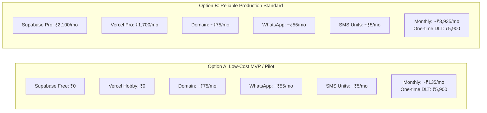

# Cost Breakdown & External Dependency Analysis

## Gym Membership Management and Automated Notification System

**Document Version:** 1.1.0 (Audited & Corrected)  
**Verification Date:** 2026-10-20  
**Lead:** Chief Technology Officer & DevOps / SRE  
**Target Scale:** 100 Active Members (Baseline), with architectural scaling models for 500 and 1,000 members  
**Currency:** Indian Rupee (INR `₹`) and US Dollar (USD `$`)  
**Important Disclaimer:** No cloud infrastructure or messaging bill can be guaranteed. Variable telecom usage, provider currency conversion, rate card adjustments, and plan changes will affect actual expenditures.

---

### 1. Executive Cost Summary & Strategy

Operating costs are structured into two distinct categories:
1. **Fixed Infrastructure Costs:** Hosting, database engine, domain registration, and scheduled compute.
2. **Variable Per-Message Costs:** WhatsApp template conversation fees and Indian DLT SMS gateway units.

To give gym leadership a realistic financial blueprint, this document outlines two concrete options:
- **Option A (Low-Cost MVP / Staging):** Leveraging developer free tiers for preliminary testing and pilot validation.
- **Option B (Reliable Production Standard):** Commercial-grade infrastructure utilizing paid tiers to guarantee SLA, backup recovery (PITR), and regulatory compliance.

---

### 2. Operational Volume Modeling (100 Members Baseline)

We model realistic membership plan distributions rather than assuming every member renews monthly:
- **Plan Distribution Breakdown:**
  - 1-Month Plan: 35% of members (35 members $\rightarrow$ 35 expiries / month)
  - 3-Month Plan: 40% of members (40 members $\rightarrow$ ~13 expiries / month)
  - 6-Month Plan: 15% of members (15 members $\rightarrow$ ~2.5 expiries / month)
  - 12-Month Plan: 10% of members (10 members $\rightarrow$ ~0.8 expiries / month)
- **Total Expiries per Month:** ~51 expiring subscriptions across the 100-member base.
- **Reminder Opportunities:** 3 per cycle (T-3 days, T-0 day, T+3 days).
  - Milestones are spaced 3 days apart; each message falls outside previous 24-hour windows.
  - Total Outbound Reminder Opportunities: $51 \times 3 = 153\text{ reminder jobs / month}$.
- **Expected Channel Distribution:**
  - WhatsApp Delivery Rate: ~90% ($153 \times 0.90 = 138\text{ messages}$).
  - Fallback SMS Required: ~10% ($153 \times 0.10 = 15\text{ messages}$).

---

### 3. Detailed Cost Itemization & Verified Provider Terms

#### 3.1. Infrastructure, Database & Compute

| Service | Plan | Fixed Monthly Cost | Stated Limits & Production Gotchas | Verification Source |
| :--- | :--- | :--- | :--- | :--- |
| **Supabase (Option A: MVP)** | Free Tier | **₹0** | 500 MB DB, daily pg_dump backups (7-day retention). **Gotcha:** Project enters inactive pause after 7 days without traffic. **No PITR.** | [VERIFIED: Supabase Pricing](https://supabase.com/pricing) |
| **Supabase (Option B: Production)** | Pro Tier | **~₹2,100 / mo** ($25 USD) | 8 GB DB, 7-day Point-in-Time Recovery (PITR), daily email quota 50k, zero inactivity pausing. | [VERIFIED: Supabase Pricing](https://supabase.com/pricing) |
| **Vercel (Option A: MVP)** | Hobby Tier | **₹0** | 100k invocations/mo. **Gotcha:** Strictly limited to **1 cron execution per 24 hours**. Strictly non-commercial personal use under TOS. | [VERIFIED: Vercel Limits](https://vercel.com/docs/cron-jobs#limits) |
| **Vercel (Option B: Production)** | Pro Tier | **~₹1,700 / mo** ($20 USD / seat) | Commercial use permitted, cron execution up to minutely (`* * * * *`), 1 TB bandwidth, advanced DDoS mitigation. | [VERIFIED: Vercel Pricing](https://vercel.com/pricing) |
| **Custom Domain & SSL** | `.in` / `.com` | **~₹75 / mo** (₹900 / yr) | Automated Let's Encrypt SSL certificates managed by Vercel. | Standard Registrar (GoDaddy/Namecheap) |

#### 3.2. Primary Messaging: Meta WhatsApp Cloud API

| Parameter | Details & Technical Reality | Official Policy Reference |
| :--- | :--- | :--- |
| **Platform** | Meta WhatsApp Business Platform (Cloud API). | [Meta WhatsApp Business Platform Pricing](https://business.whatsapp.com/pricing) |
| **Template Category** | **Utility Template:** Pre-approved transactional expiry alerts. | Meta Business Messaging Policy |
| **Free Tier Caveat** | Meta's 1,000 free conversations/month apply **strictly to user-initiated service conversations**, NOT business-initiated utility or marketing templates. | [VERIFIED: Meta Developer Docs](https://developers.facebook.com/docs/whatsapp/pricing) |
| **Unit Rate (India - INR)** | Approximately **₹0.35 to ₹0.40 per 24-hour utility conversation**. | [UNVERIFIED: Meta WhatsApp rate card varies by country and changes periodically; must be verified directly inside the Meta Business Manager for the specific business currency]. |
| **Monthly Variable (100 Members)** | $138\text{ conversations} \times ₹0.38\text{ avg} \approx \mathbf{₹52.44 / \text{month}}$. | Volume-dependent variable cost. |

#### 3.3. Fallback Messaging: Indian SMS & Regulatory Compliance

| Parameter | Regulatory Requirement & Pricing | Impact & Notes |
| :--- | :--- | :--- |
| **TRAI DLT Registration** | Telecom Regulatory Authority of India (TRAI) mandates Enterprise Principal Entity registration on DLT platforms (Vil Power, Jio DLT, or Airtel DLT). | **One-time Fee: ~₹5,900 INR** (₹5,000 + 18% GST). Mandatory before sending commercial SMS in India. [VERIFIED: TRAI TCCCPR Regulations]. |
| **SMS Header (Sender ID)** | 6-character Alpha header (e.g., `GYMREG`). | Included in initial DLT registration or nominal annual fee. |
| **DLT Content Template** | Pre-registration of exact message template with variables `{#var#}`. | Free registration on DLT portal. |
| **Transactional SMS Units** | Domestic SMS unit via aggregator (Fast2SMS / MSG91). | **~₹0.18 to ₹0.25 per 160-char SMS**. |
| **Monthly Variable (100 Members)** | $15\text{ fallback SMS} \times ₹0.22\text{ avg} \approx \mathbf{₹3.30 / \text{month}}$. | Ultra-low recurring fallback cost. |

---

### 4. Option A vs. Option B Cost Comparison

| Cost Element | Option A: Low-Cost MVP (100 Members) | Option B: Reliable Production (100 Members) | Option B at Scale (1,000 Members) |
| :--- | :--- | :--- | :--- |
| **Database & Auth** | ₹0 (Free tier, daily backup, no PITR) | ₹2,100 / mo ($25 Supabase Pro with PITR) | ₹2,100 / mo (Fits in Pro 8GB) |
| **Compute & Functions** | ₹0 (Hobby, 1 cron/day, non-commercial) | ₹1,700 / mo ($20 Vercel Pro, minutely cron) | ₹1,700 / mo |
| **Domain & SSL** | ~₹75 / mo | ~₹75 / mo | ~₹75 / mo |
| **WhatsApp Messages** | ~₹55 / mo (138 utility convos) | ~₹55 / mo (138 utility convos) | ~₹550 / mo (1,380 utility convos) |
| **SMS Fallback Units** | ~₹5 / mo (15 fallback SMS) | ~₹5 / mo (15 fallback SMS) | ~₹50 / mo (150 fallback SMS) |
| **Total Monthly Recurring** | **~₹135 / month (~$1.60 USD)** | **~₹3,935 / month (~$47 USD)** | **~₹4,475 / month (~$54 USD)** |
| **One-Time Regulatory Setup** | ₹5,900 (TRAI DLT Portal Registration) | ₹5,900 (TRAI DLT Portal Registration) | ₹0 (Already registered) |

---

### 5. External Accounts, Verifications & Approvals Checklist

The following external dependencies require administrative business registration and cannot be bypassed purely via software code:

1. **Meta Business Manager & WhatsApp API:**
   - [ ] Meta Business Account creation.
   - [ ] Legal Business Verification (submission of GST certificate, MSME Udyam, or Business PAN).
   - [ ] Dedicated mobile phone number not registered on personal WhatsApp.
   - [ ] Submission and Meta approval of the `membership_expiry_reminder` Utility template.
   - [ ] System User creation and permanent access token generation.
2. **Indian Telecom DLT Portal (Jio / Vodafone-Idea / Airtel):**
   - [ ] Principal Entity (PE) registration with business KYC documents.
   - [ ] Payment of one-time registration fee (~₹5,900).
   - [ ] Header approval (e.g., `GYMREG`).
   - [ ] Content Template registration and approval for expiry reminders.
3. **SMS Gateway Account (Fast2SMS / MSG91):**
   - [ ] API account creation and linking with verified DLT Entity ID and Header.
   - [ ] Initial credit recharge (e.g., ₹500 test credit bundle).
4. **Cloud Infrastructure Accounts:**
   - [ ] Supabase project initialization (Singapore region `ap-southeast-1` recommended for lowest latency to India).
   - [ ] Vercel deployment project linked to GitHub repository.
