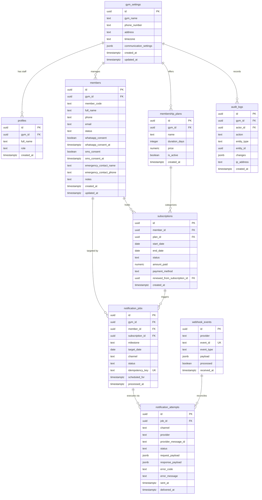

# Database Design & Schema Specification

## Gym Membership Management and Automated Notification System

**Document Version:** 1.0.0  
**Status:** Approved for Technical Architecture  
**Database Engine:** PostgreSQL 15+ (Supabase)  
**Schema:** `public`  
**Timezone Standard:** `timestamptz` (All timestamps stored in UTC, presented in `Asia/Kolkata`)

---

### 1. Entity-Relationship (ER) Diagram



---

### 2. Complete PostgreSQL DDL Specification

Below is the production-grade SQL migration creating extensions, tables, constraints, foreign keys, triggers, and Row Level Security (RLS) policies.

```sql
-- ============================================================================
-- 001_initial_schema.sql
-- Extensions & Custom Types
-- ============================================================================

CREATE EXTENSION IF NOT EXISTS "uuid-ossp";
CREATE EXTENSION IF NOT EXISTS "citext";
CREATE EXTENSION IF NOT EXISTS "pgcrypto";
CREATE EXTENSION IF NOT EXISTS "btree_gist";

-- Custom Domain Enums
DO $$ BEGIN
    CREATE TYPE member_status_enum AS ENUM ('active', 'expiring', 'expired', 'archived');
EXCEPTION
    WHEN duplicate_object THEN null;
END $$;

DO $$ BEGIN
    CREATE TYPE subscription_status_enum AS ENUM ('active', 'expired', 'cancelled', 'superseded');
EXCEPTION
    WHEN duplicate_object THEN null;
END $$;

DO $$ BEGIN
    CREATE TYPE notification_milestone_enum AS ENUM ('EXPIRY_MINUS_3', 'EXPIRY_ZERO', 'EXPIRY_PLUS_3', 'MANUAL_TRIGGER');
EXCEPTION
    WHEN duplicate_object THEN null;
END $$;

-- Decoupled Job Lifecycle Enum (Worker Queue State with Two-Phase Intent & Reconciliation)
DO $$ BEGIN
    CREATE TYPE notification_job_status_enum AS ENUM ('pending', 'claimed', 'dispatching', 'reconciling', 'completed', 'failed', 'skipped', 'cancelled');
EXCEPTION
    WHEN duplicate_object THEN null;
END $$;

-- Decoupled Attempt Lifecycle Enum (Provider Invocation & Failure Classification State)
DO $$ BEGIN
    CREATE TYPE notification_attempt_status_enum AS ENUM ('initiated', 'dispatching', 'sent', 'delivered', 'read', 'failed_permanent', 'failed_transient', 'unknown', 'unconfirmed_stale');
EXCEPTION
    WHEN duplicate_object THEN null;
END $$;

DO $$ BEGIN
    CREATE TYPE notification_channel_enum AS ENUM ('whatsapp', 'sms');
EXCEPTION
    WHEN duplicate_object THEN null;
END $$;

-- Generic update timestamp trigger function with hardened search_path (SECURITY INVOKER)
CREATE OR REPLACE FUNCTION public.update_updated_at_column()
RETURNS TRIGGER 
LANGUAGE plpgsql
SECURITY INVOKER
SET search_path = pg_catalog
AS $$
BEGIN
    NEW.updated_at = pg_catalog.now();
    RETURN NEW;
END;
$$;

-- ============================================================================
-- 1. Table: gym_settings (Gym Business Profile)
-- ============================================================================

CREATE TABLE IF NOT EXISTS gym_settings (
    id UUID PRIMARY KEY DEFAULT gen_random_uuid(),
    gym_name TEXT NOT NULL CHECK (char_length(trim(gym_name)) >= 2),
    phone_number TEXT NOT NULL CHECK (phone_number ~ '^\+91[6-9][0-9]{9}$'),
    address TEXT,
    timezone TEXT NOT NULL DEFAULT 'Asia/Kolkata',
    currency TEXT NOT NULL DEFAULT 'INR',
    reminder_send_hour INTEGER NOT NULL DEFAULT 10 CHECK (reminder_send_hour BETWEEN 7 AND 21),
    communication_settings JSONB NOT NULL DEFAULT '{
        "whatsapp_enabled": false,
        "whatsapp_phone_number_id": null,
        "sms_fallback_enabled": false,
        "sms_provider": "fast2sms",
        "dlt_principal_entity_id": null,
        "dlt_sender_header": null
    }'::jsonb,
    created_at TIMESTAMPTZ NOT NULL DEFAULT NOW(),
    updated_at TIMESTAMPTZ NOT NULL DEFAULT NOW()
);

CREATE TRIGGER trg_gym_settings_updated_at
BEFORE UPDATE ON gym_settings
FOR EACH ROW EXECUTE FUNCTION update_updated_at_column();

-- ============================================================================
-- 2. Table: profiles (Staff & Admin Accounts mapped to auth.users)
-- ============================================================================

CREATE TABLE IF NOT EXISTS profiles (
    id UUID PRIMARY KEY REFERENCES auth.users(id) ON DELETE CASCADE,
    gym_id UUID NOT NULL REFERENCES gym_settings(id) ON DELETE RESTRICT,
    full_name TEXT NOT NULL CHECK (char_length(trim(full_name)) >= 2),
    role TEXT NOT NULL DEFAULT 'staff' CHECK (role IN ('owner', 'admin', 'staff')),
    created_at TIMESTAMPTZ NOT NULL DEFAULT NOW(),
    updated_at TIMESTAMPTZ NOT NULL DEFAULT NOW()
);

CREATE TRIGGER trg_profiles_updated_at
BEFORE UPDATE ON profiles
FOR EACH ROW EXECUTE FUNCTION update_updated_at_column();

-- ============================================================================
-- 3. Table: members (Customer Directory & Consent Tracking)
-- ============================================================================

CREATE TABLE IF NOT EXISTS members (
    id UUID PRIMARY KEY DEFAULT gen_random_uuid(),
    gym_id UUID NOT NULL REFERENCES gym_settings(id) ON DELETE RESTRICT,
    member_code TEXT NOT NULL,
    full_name TEXT NOT NULL CHECK (char_length(trim(full_name)) >= 2),
    phone TEXT NOT NULL CHECK (phone ~ '^\+91[6-9][0-9]{9}$'),
    email CITEXT CHECK (email IS NULL OR email ~ '^[A-Za-z0-9._%+-]+@[A-Za-z0-9.-]+\.[A-Za-z]{2,}$'),
    gender TEXT CHECK (gender IN ('male', 'female', 'other', 'prefer_not_to_say')),
    date_of_birth DATE CHECK (date_of_birth IS NULL OR date_of_birth <= CURRENT_DATE),
    emergency_contact_name TEXT,
    emergency_contact_phone TEXT CHECK (emergency_contact_phone IS NULL OR emergency_contact_phone ~ '^\+91[6-9][0-9]{9}$'),
    notes TEXT,
    status member_status_enum NOT NULL DEFAULT 'active',
    
    -- Regulatory Consent Columns (DPDP Act Compliance)
    whatsapp_consent BOOLEAN NOT NULL DEFAULT true,
    whatsapp_consent_at TIMESTAMPTZ DEFAULT NOW(),
    whatsapp_consent_source TEXT DEFAULT 'front_desk_registration',
    
    sms_consent BOOLEAN NOT NULL DEFAULT true,
    sms_consent_at TIMESTAMPTZ DEFAULT NOW(),
    sms_consent_source TEXT DEFAULT 'front_desk_registration',
    
    created_at TIMESTAMPTZ NOT NULL DEFAULT NOW(),
    updated_at TIMESTAMPTZ NOT NULL DEFAULT NOW(),
    
    CONSTRAINT uq_members_gym_code UNIQUE (gym_id, member_code)
);

-- Partial unique index allowing re-registration after archiving
CREATE UNIQUE INDEX uq_members_gym_phone_active ON members(gym_id, phone) WHERE status != 'archived';

CREATE INDEX idx_members_gym_status ON members(gym_id, status);
CREATE INDEX idx_members_phone ON members(phone);
CREATE INDEX idx_members_search ON members USING gin(to_tsvector('english', full_name || ' ' || member_code || ' ' || phone));

CREATE TRIGGER trg_members_updated_at
BEFORE UPDATE ON members
FOR EACH ROW EXECUTE FUNCTION update_updated_at_column();

-- ============================================================================
-- 4. Table: membership_plans (Plan Catalog)
-- ============================================================================

CREATE TABLE IF NOT EXISTS membership_plans (
    id UUID PRIMARY KEY DEFAULT gen_random_uuid(),
    gym_id UUID NOT NULL REFERENCES gym_settings(id) ON DELETE RESTRICT,
    name TEXT NOT NULL CHECK (char_length(trim(name)) >= 2),
    duration_days INTEGER NOT NULL CHECK (duration_days > 0),
    price NUMERIC(10, 2) NOT NULL CHECK (price >= 0),
    description TEXT,
    is_active BOOLEAN NOT NULL DEFAULT true,
    created_at TIMESTAMPTZ NOT NULL DEFAULT NOW(),
    updated_at TIMESTAMPTZ NOT NULL DEFAULT NOW(),
    CONSTRAINT uq_plans_gym_name UNIQUE (gym_id, name)
);

CREATE INDEX idx_plans_gym_active ON membership_plans(gym_id, is_active);

-- ============================================================================
-- 5. Table: subscriptions (Membership Periods & Renewal History)
-- ============================================================================

CREATE TABLE IF NOT EXISTS subscriptions (
    id UUID PRIMARY KEY DEFAULT gen_random_uuid(),
    gym_id UUID NOT NULL REFERENCES gym_settings(id) ON DELETE RESTRICT,
    member_id UUID NOT NULL REFERENCES members(id) ON DELETE RESTRICT,
    plan_id UUID NOT NULL REFERENCES membership_plans(id) ON DELETE RESTRICT,
    start_date DATE NOT NULL,
    end_date DATE NOT NULL,
    status subscription_status_enum NOT NULL DEFAULT 'active',
    amount_paid NUMERIC(10, 2) NOT NULL CHECK (amount_paid >= 0),
    payment_method TEXT NOT NULL DEFAULT 'cash' CHECK (payment_method IN ('cash', 'upi', 'card', 'bank_transfer', 'other')),
    notes TEXT,
    
    -- Client Renewal Request Idempotency Key (prevents duplicate submissions on network retry)
    idempotency_key TEXT,
    
    -- Staff attribution for accountability
    created_by UUID REFERENCES profiles(id) ON DELETE RESTRICT,
    
    -- Optimistic Concurrency Control Version Counter
    version INTEGER NOT NULL DEFAULT 1,
    
    -- Self-referential FK preserving renewal lineage (A subscription can only be renewed once)
    renewed_from_subscription_id UUID REFERENCES subscriptions(id) ON DELETE SET NULL,
    
    created_at TIMESTAMPTZ NOT NULL DEFAULT NOW(),
    updated_at TIMESTAMPTZ NOT NULL DEFAULT NOW(),
    
    CONSTRAINT chk_subscription_dates CHECK (end_date >= start_date),
    
    -- Exclusion Constraint: Guarantees zero overlapping active coverage periods for the same member
    CONSTRAINT no_overlapping_active_subscriptions 
    EXCLUDE USING gist (
        member_id WITH =,
        daterange(start_date, end_date, '[]') WITH &&
    ) WHERE (status = 'active')
);

-- Client renewal idempotency index
CREATE UNIQUE INDEX uq_subscriptions_gym_idempotency ON subscriptions(gym_id, idempotency_key) 
WHERE idempotency_key IS NOT NULL;

CREATE UNIQUE INDEX uq_subscriptions_renewed_from ON subscriptions(renewed_from_subscription_id) 
WHERE renewed_from_subscription_id IS NOT NULL;

CREATE INDEX idx_subscriptions_member_dates ON subscriptions(member_id, start_date, end_date);
CREATE INDEX idx_subscriptions_expiry_lookup ON subscriptions(end_date, status);
CREATE INDEX idx_subscriptions_gym_status ON subscriptions(gym_id, status);

CREATE TRIGGER trg_subscriptions_updated_at
BEFORE UPDATE ON subscriptions
FOR EACH ROW EXECUTE FUNCTION update_updated_at_column();

-- ============================================================================
-- 6. Table: notification_jobs (Queue, Leases & Scheduled Reminders)
-- ============================================================================

CREATE TABLE IF NOT EXISTS notification_jobs (
    id UUID PRIMARY KEY DEFAULT gen_random_uuid(),
    gym_id UUID NOT NULL REFERENCES gym_settings(id) ON DELETE RESTRICT,
    member_id UUID NOT NULL REFERENCES members(id) ON DELETE RESTRICT,
    subscription_id UUID NOT NULL REFERENCES subscriptions(id) ON DELETE RESTRICT,
    milestone notification_milestone_enum NOT NULL,
    target_date DATE NOT NULL,
    channel notification_channel_enum NOT NULL DEFAULT 'whatsapp',
    status notification_job_status_enum NOT NULL DEFAULT 'pending',
    
    -- Deterministic uniqueness preventing duplicate jobs
    idempotency_key TEXT NOT NULL UNIQUE,
    
    scheduled_for TIMESTAMPTZ NOT NULL,
    
    -- Distributed Worker Lease Management
    claimed_at TIMESTAMPTZ,
    lease_expires_at TIMESTAMPTZ,
    worker_id TEXT,
    attempt_count INTEGER NOT NULL DEFAULT 0,
    max_attempts INTEGER NOT NULL DEFAULT 3,
    
    processed_at TIMESTAMPTZ,
    cancellation_reason TEXT,
    created_at TIMESTAMPTZ NOT NULL DEFAULT NOW(),
    updated_at TIMESTAMPTZ NOT NULL DEFAULT NOW()
);

-- Index supporting fast queue claiming and expired lease recovery
CREATE INDEX idx_jobs_claim_recovery ON notification_jobs(status, scheduled_for, lease_expires_at) 
WHERE status IN ('pending', 'claimed');

-- Index supporting periodic reconciliation sweeper for ambiguous timeouts
CREATE INDEX idx_jobs_reconciliation ON notification_jobs(status, updated_at) 
WHERE status = 'reconciling';

CREATE INDEX idx_jobs_member_sub ON notification_jobs(member_id, subscription_id);

CREATE TRIGGER trg_jobs_updated_at
BEFORE UPDATE ON notification_jobs
FOR EACH ROW EXECUTE FUNCTION update_updated_at_column();

-- ============================================================================
-- 7. Table: notification_attempts (Individual Dispatches & Provider Receipts)
-- ============================================================================

CREATE TABLE IF NOT EXISTS notification_attempts (
    id UUID PRIMARY KEY DEFAULT gen_random_uuid(),
    job_id UUID NOT NULL REFERENCES notification_jobs(id) ON DELETE CASCADE,
    channel notification_channel_enum NOT NULL,
    provider TEXT NOT NULL, -- 'meta_whatsapp', 'fast2sms', 'msg91'
    provider_message_id TEXT, -- e.g. wamid.HBgL... or SMS gateway reference ID
    status notification_attempt_status_enum NOT NULL DEFAULT 'initiated',
    request_payload JSONB,
    response_payload JSONB,
    error_code TEXT,
    error_message TEXT,
    sent_at TIMESTAMPTZ NOT NULL DEFAULT NOW(),
    delivered_at TIMESTAMPTZ,
    created_at TIMESTAMPTZ NOT NULL DEFAULT NOW()
);

CREATE INDEX idx_attempts_job_id ON notification_attempts(job_id);
CREATE INDEX idx_attempts_provider_msg ON notification_attempts(provider_message_id);

-- ============================================================================
-- 8. Table: webhook_events (Inbound Webhook Audit & Deduplication)
-- ============================================================================

CREATE TABLE IF NOT EXISTS webhook_events (
    id UUID PRIMARY KEY DEFAULT gen_random_uuid(),
    provider TEXT NOT NULL,
    event_id TEXT NOT NULL UNIQUE, -- Provider unique ID or hash(payload)
    event_type TEXT NOT NULL,
    payload JSONB NOT NULL,
    processed BOOLEAN NOT NULL DEFAULT false,
    processing_error TEXT,
    received_at TIMESTAMPTZ NOT NULL DEFAULT NOW()
);

CREATE INDEX idx_webhook_events_unprocessed ON webhook_events(processed) WHERE processed = false;

-- ============================================================================
-- 9. Table: audit_logs (Administrative Activity Trail)
-- ============================================================================

CREATE TABLE IF NOT EXISTS audit_logs (
    id UUID PRIMARY KEY DEFAULT gen_random_uuid(),
    gym_id UUID NOT NULL REFERENCES gym_settings(id) ON DELETE RESTRICT,
    actor_id UUID REFERENCES auth.users(id) ON DELETE SET NULL,
    action TEXT NOT NULL, -- 'member.create', 'subscription.renew', 'job.retry'
    entity_type TEXT NOT NULL,
    entity_id UUID,
    changes JSONB,
    ip_address TEXT,
    user_agent TEXT,
    created_at TIMESTAMPTZ NOT NULL DEFAULT NOW()
);

CREATE INDEX idx_audit_logs_gym_created ON audit_logs(gym_id, created_at DESC);
```

---

### 3. Automated Invalidation Trigger: Renewal Protection

To guarantee requirement **C: "Prevent old subscription reminders from being sent after a renewal"**, we implement a PostgreSQL database trigger. Whenever a new subscription is created or an existing subscription's `end_date` is extended, any `pending` notification jobs tied to the member's prior subscriptions are automatically transitioned to `cancelled`.

```sql
-- Trigger Function: Cancel pending reminder jobs upon renewal or extension with hardened search_path
CREATE OR REPLACE FUNCTION public.cancel_stale_notification_jobs_on_renewal()
RETURNS TRIGGER 
LANGUAGE plpgsql
SECURITY DEFINER
SET search_path = pg_catalog
AS $$
BEGIN
    -- Input boundary validation
    IF NEW.member_id IS NULL OR NEW.gym_id IS NULL THEN
        RAISE EXCEPTION 'Invalid subscription record: member_id and gym_id are required.';
    END IF;

    -- Cancel all pending jobs for prior subscriptions of this member
    UPDATE public.notification_jobs
    SET 
        status = 'cancelled'::public.notification_job_status_enum,
        cancellation_reason = 'subscription_renewed_or_extended',
        updated_at = pg_catalog.now()
    WHERE 
        member_id = NEW.member_id
        AND gym_id = NEW.gym_id
        AND subscription_id != NEW.id
        AND status = 'pending'::public.notification_job_status_enum;

    -- Ensure member status is active
    UPDATE public.members
    SET 
        status = 'active'::public.member_status_enum,
        updated_at = pg_catalog.now()
    WHERE id = NEW.member_id AND gym_id = NEW.gym_id;

    RETURN NEW;
END;
$$;

-- Restrict trigger execution to system/internal only
REVOKE ALL ON FUNCTION public.cancel_stale_notification_jobs_on_renewal() FROM PUBLIC;
REVOKE ALL ON FUNCTION public.cancel_stale_notification_jobs_on_renewal() FROM anon;
REVOKE ALL ON FUNCTION public.cancel_stale_notification_jobs_on_renewal() FROM authenticated;

CREATE TRIGGER trg_cancel_stale_jobs_after_subscription
AFTER INSERT OR UPDATE OF end_date ON subscriptions
FOR EACH ROW EXECUTE FUNCTION public.cancel_stale_notification_jobs_on_renewal();
```

---

### 4. Row Level Security (RLS) Policies & Privileged Functions

All public tables have RLS enabled to guarantee complete multi-tenant isolation and enforce least-privilege access. Privileged functions are explicitly hardened against search-path injection, object shadowing, and unauthorized RPC invocation.

```sql
-- Enable RLS across all application tables
ALTER TABLE gym_settings ENABLE ROW LEVEL SECURITY;
ALTER TABLE profiles ENABLE ROW LEVEL SECURITY;
ALTER TABLE members ENABLE ROW LEVEL SECURITY;
ALTER TABLE membership_plans ENABLE ROW LEVEL SECURITY;
ALTER TABLE subscriptions ENABLE ROW LEVEL SECURITY;
ALTER TABLE notification_jobs ENABLE ROW LEVEL SECURITY;
ALTER TABLE notification_attempts ENABLE ROW LEVEL SECURITY;
ALTER TABLE audit_logs ENABLE ROW LEVEL SECURITY;
ALTER TABLE webhook_events ENABLE ROW LEVEL SECURITY;

-- Helper function: Hardened against search_path hijacking and object shadowing
CREATE OR REPLACE FUNCTION public.current_user_gym_id()
RETURNS UUID 
LANGUAGE sql
STABLE
SECURITY DEFINER
SET search_path = pg_catalog
AS $$
    SELECT p.gym_id 
    FROM public.profiles p 
    WHERE p.id = (auth.uid()) 
    LIMIT 1;
$$;

-- Revoke execute from public/anon; grant strictly to authenticated and service_role
REVOKE ALL ON FUNCTION public.current_user_gym_id() FROM PUBLIC;
REVOKE ALL ON FUNCTION public.current_user_gym_id() FROM anon;
GRANT EXECUTE ON FUNCTION public.current_user_gym_id() TO authenticated;
GRANT EXECUTE ON FUNCTION public.current_user_gym_id() TO service_role;

-- Worker Queue Claim RPC with Two-Phase Dispatch Intent Guard
CREATE OR REPLACE FUNCTION public.claim_notification_jobs(
    p_worker_id text,
    p_batch_size integer DEFAULT 25,
    p_lease_duration_seconds integer DEFAULT 300
)
RETURNS SETOF public.notification_jobs
LANGUAGE plpgsql
SECURITY DEFINER
SET search_path = pg_catalog
AS $$
DECLARE
    v_lease_interval interval;
BEGIN
    IF p_worker_id IS NULL OR pg_catalog.trim(p_worker_id) = '' THEN
        RAISE EXCEPTION 'Worker ID must be provided to claim jobs.';
    END IF;
    
    v_lease_interval := (pg_catalog.concat(p_lease_duration_seconds::text, ' seconds'))::interval;

    RETURN QUERY
    WITH eligible_jobs AS (
        SELECT id
        FROM public.notification_jobs
        WHERE 
            (status = 'pending'::public.notification_job_status_enum AND scheduled_for <= pg_catalog.now())
            OR 
            (
                status = 'claimed'::public.notification_job_status_enum 
                AND lease_expires_at < pg_catalog.now() 
                AND attempt_count < max_attempts
                -- CRITICAL GUARD: Only reclaim if no dispatch attempt was ever initiated
                AND NOT EXISTS (
                    SELECT 1 FROM public.notification_attempts a 
                    WHERE a.job_id = public.notification_jobs.id 
                    AND a.status IN ('dispatching'::public.notification_attempt_status_enum, 'sent'::public.notification_attempt_status_enum, 'unknown'::public.notification_attempt_status_enum)
                )
            )
        ORDER BY scheduled_for ASC
        LIMIT p_batch_size
        FOR UPDATE SKIP LOCKED
    )
    UPDATE public.notification_jobs j
    SET 
        status = 'claimed'::public.notification_job_status_enum,
        claimed_at = pg_catalog.now(),
        lease_expires_at = pg_catalog.now() + v_lease_interval,
        worker_id = p_worker_id,
        attempt_count = j.attempt_count + 1,
        updated_at = pg_catalog.now()
    FROM eligible_jobs e
    WHERE j.id = e.id
    RETURNING j.*;
END;
$$;

REVOKE ALL ON FUNCTION public.claim_notification_jobs(text, integer, integer) FROM PUBLIC;
REVOKE ALL ON FUNCTION public.claim_notification_jobs(text, integer, integer) FROM anon;
REVOKE ALL ON FUNCTION public.claim_notification_jobs(text, integer, integer) FROM authenticated;
GRANT EXECUTE ON FUNCTION public.claim_notification_jobs(text, integer, integer) TO service_role;

-- 1. gym_settings Policies
CREATE POLICY "Staff can view their gym settings"
ON gym_settings FOR SELECT
TO authenticated
USING (id = current_user_gym_id());

CREATE POLICY "Owners can update their gym settings"
ON gym_settings FOR UPDATE
TO authenticated
USING (id = current_user_gym_id() AND EXISTS (
    SELECT 1 FROM profiles WHERE id = auth.uid() AND role IN ('owner', 'admin')
));

-- 2. profiles Policies
CREATE POLICY "Staff can view profiles in their gym"
ON profiles FOR SELECT
TO authenticated
USING (gym_id = current_user_gym_id());

CREATE POLICY "Owners can manage staff profiles"
ON profiles FOR ALL
TO authenticated
USING (gym_id = current_user_gym_id() AND EXISTS (
    SELECT 1 FROM profiles WHERE id = auth.uid() AND role IN ('owner', 'admin')
));

-- 3. membership_plans Policies
CREATE POLICY "Staff can view plans in their gym"
ON membership_plans FOR SELECT
TO authenticated
USING (gym_id = current_user_gym_id());

CREATE POLICY "Admins can manage plans in their gym"
ON membership_plans FOR ALL
TO authenticated
USING (gym_id = current_user_gym_id() AND EXISTS (
    SELECT 1 FROM profiles WHERE id = auth.uid() AND role IN ('owner', 'admin')
));

-- 4. members Policies
CREATE POLICY "Staff can view members in their gym"
ON members FOR SELECT
TO authenticated
USING (gym_id = current_user_gym_id());

CREATE POLICY "Staff can insert members in their gym"
ON members FOR INSERT
TO authenticated
WITH CHECK (gym_id = current_user_gym_id());

CREATE POLICY "Staff can update members in their gym"
ON members FOR UPDATE
TO authenticated
USING (gym_id = current_user_gym_id())
WITH CHECK (gym_id = current_user_gym_id());

-- 5. subscriptions Policies
CREATE POLICY "Staff can view subscriptions in their gym"
ON subscriptions FOR SELECT
TO authenticated
USING (gym_id = current_user_gym_id());

CREATE POLICY "Staff can insert subscriptions in their gym"
ON subscriptions FOR INSERT
TO authenticated
WITH CHECK (gym_id = current_user_gym_id());

CREATE POLICY "Staff can update subscriptions in their gym"
ON subscriptions FOR UPDATE
TO authenticated
USING (gym_id = current_user_gym_id())
WITH CHECK (gym_id = current_user_gym_id());

-- 6. notification_jobs & notification_attempts Policies
CREATE POLICY "Staff can view notification jobs in their gym"
ON notification_jobs FOR SELECT
TO authenticated
USING (gym_id = current_user_gym_id());

CREATE POLICY "Staff can view notification attempts in their gym"
ON notification_attempts FOR SELECT
TO authenticated
USING (EXISTS (
    SELECT 1 FROM notification_jobs j 
    WHERE j.id = notification_attempts.job_id AND j.gym_id = current_user_gym_id()
));

-- 7. audit_logs Policies
CREATE POLICY "Staff can view audit logs in their gym"
ON audit_logs FOR SELECT
TO authenticated
USING (gym_id = current_user_gym_id());

-- 8. Webhook & Service Role Only Tables
CREATE POLICY "Service role full access to webhook_events"
ON webhook_events FOR ALL
TO service_role
USING (true)
WITH CHECK (true);
```

---

### 5. Data Retention & Purge Policies

| Table | Retention Period | Purge Mechanism | Justification |
| :--- | :--- | :--- | :--- |
| `webhook_events` | 30 Days | Scheduled pg_cron cleanup | Payloads contain ephemeral provider metadata; raw JSON consumes storage. |
| `notification_attempts` | 90 Days | Archived to aggregate counts | High volume; delivery verification needed only for immediate troubleshooting. |
| `notification_jobs` | 1 Year | Retained for audit | Proves compliance with messaging policies and provides historical renewal metrics. |
| `audit_logs` | 2 Years | Read-only partition | Critical legal and operational audit trail for staff accountability. |
| `members` & `subscriptions` | Indefinite | Soft-delete / `archived` | Preserves financial and business performance records. |
