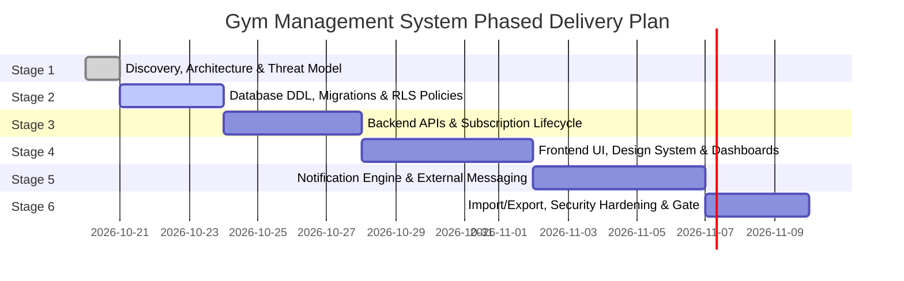

# Implementation Roadmap & Engineering Phasing

## Gym Membership Management and Automated Notification System

**Document Version:** 1.0.0  
**Status:** Approved for Technical Architecture  
**Lead:** Product Manager & Chief Technology Officer  
**Execution Methodology:** Phased Delivery with Strict Acceptance Exit Gates

---

### 1. Phased Delivery Overview

The project is divided into six disciplined, sequential stages. Implementation of subsequent stages must not begin until the preceding stage satisfies its explicit exit gates and acceptance criteria.

---

### 2. Stage-by-Stage Specifications

#### Stage 1: Product Discovery, Architecture & Technical Blueprint (CURRENT)
- **Primary Focus:** Discovery, workspace inspection, architectural decisions, data modeling, threat modeling, cost analysis, and technical blueprinting.
- **Dependencies:** None.
- **Deliverables:**
  - `docs/PRODUCT_REQUIREMENTS.md`
  - `docs/SYSTEM_ARCHITECTURE.md`
  - `docs/DATABASE_DESIGN.md`
  - `docs/API_DESIGN.md`
  - `docs/SECURITY_THREAT_MODEL.md`
  - `docs/TEST_STRATEGY.md`
  - `docs/COST_AND_DEPENDENCIES.md`
  - `docs/IMPLEMENTATION_ROADMAP.md`
  - `docs/STAGE_1_AUDIT_REPORT.md`
  - `docs/STAGE_1C_SECURITY_RELIABILITY_REVIEW.md`
  - `SECURITY.md`
- **Tests & Verification:** Rigorous Stage 1 architecture audit (Master Prompt 01B) and Stage 1C reliability review, cross-document consistency checks, and manual technical review.
- **Stage 1 Exit Gate:** All 11 architecture, security, and audit documents completed, workspace constraints evaluated, and user formal review and approval received before any application code or database migrations are created.

---

#### Stage 2: Database Layer, Schema Migrations & RLS Enforcement
- **Primary Focus:** Establishing version-controlled SQL migrations, database constraints, automated triggers, and Row Level Security isolation.
- **Dependencies:** Stage 1 approval; initialized Supabase project.
- **Deliverables:**
  - Version-controlled migration files in `supabase/migrations/`.
  - Extension initialization (`uuid-ossp`, `citext`, `pgcrypto`, `btree_gist`).
  - Table schemas (`gym_settings`, `profiles`, `members`, `membership_plans`, `subscriptions`, `notification_jobs`, `notification_attempts`, `webhook_events`, `audit_logs`).
  - Hardened database functions (`current_user_gym_id`, `cancel_stale_notification_jobs_on_renewal`, `claim_notification_jobs`, `update_updated_at_column`) with `search_path = pg_catalog`, qualified objects, and explicit REVOKE/GRANT rules.
  - Exclusion constraint `no_overlapping_active_subscriptions` preventing overlapping active subscriptions.
  - Automated triggers: `updated_at` timestamps, renewal cancellation trigger (`trg_cancel_stale_jobs_after_subscription`).
  - Declarative RLS policies for tenant data isolation.
  - Development seed data script with sanitized, realistic test members.
- **Tests & Verification:**
  - Database migration applying cleanly to a blank test instance.
  - Constraint tests (duplicate phone rejection, inverted date rejection, exclusion overlap rejection).
  - pgTAP / SQL tests proving cross-tenant RLS isolation and unprivileged RPC rejection.
- **Stage 2 Exit Gate:** Migrations pass automated validation; RLS policies and exclusion constraints successfully block unauthorized data queries and overlapping subscriptions in automated tests.

---

#### Stage 3: Core Backend APIs & Subscription Business Logic
- **Primary Focus:** Developing secure serverless API endpoints with runtime validation, error handling, and transactional lifecycle operations.
- **Dependencies:** Stage 2 database migrations.
- **Deliverables:**
  - Centralized API middleware: Supabase JWT authentication verifier, tenant extraction, structured logger with PII masking, RFC 7807 error formatter.
  - Member endpoints (`GET`, `POST`, `PATCH`, `DELETE /api/members`).
  - Plan catalog endpoints (`GET`, `POST`, `PATCH /api/plans`).
  - Subscription renewal endpoint (`POST /api/subscriptions/renew`) with client UUID `idempotency_key`, row-level locking, non-destructive lineage, and exclusion violation handling.
  - Dashboard telemetry endpoint (`GET /api/dashboard/stats`).
  - Zod validation schemas for all request payloads.
- **Tests & Verification:**
  - Integration API tests with Supertest asserting 200, 400, 401, 403, and 409 responses.
  - Renewal verification test asserting previous subscription remains intact, idempotent re-submission returns existing record, and pending reminder jobs transition to `cancelled`.
- **Stage 3 Exit Gate:** 100% of core REST endpoints pass automated integration test suite with zero unhandled exceptions.

---

#### Stage 4: Frontend Development, Responsive UI & State Management
- **Primary Focus:** Building the rich, accessible, responsive admin web application using React, Vite, Tailwind CSS, and Lucide React.
- **Dependencies:** Stage 3 backend endpoints.
- **Deliverables:**
  - Vite + React + TypeScript application scaffolding.
  - Tailwind CSS design system with custom color tokens, modern typography (Inter), glassmorphism accents, and responsive layout primitives.
  - Responsive App Shell (Navigation Sidebar, Header, User Profile, Tenant Indicator).
  - Admin Dashboard screen (KPI cards, today's reminder feed, operational alerts).
  - Member Management screen (Data table, search, filters, pagination, member details modal, add/edit drawer).
  - Subscription & Renewal modal with instant end-date calculation and payment method capture.
  - Membership Plans screen (Catalog cards, create/archive modals).
  - UI states: Skeleton loaders, empty states, and toast notifications.
- **Tests & Verification:**
  - Component rendering unit tests with React Testing Library.
  - Responsive viewport checks (Desktop 1920x1080, Tablet 768x1024, Mobile 375x812).
  - Accessibility audit (WCAG AA compliance for contrast and form labels).
- **Stage 4 Exit Gate:** Admin interface fully interactive against real backend APIs with smooth transitions and zero layout shifts.

---

#### Stage 5: Automated Notification Engine & External Integrations
- **Primary Focus:** Implementing the scheduled reminder pipeline, Meta WhatsApp Cloud API integration, Indian DLT SMS fallback, and webhook ingestion.
- **Dependencies:** Stage 3 backend APIs, Stage 4 UI.
- **Deliverables:**
  - Cron evaluation endpoint (`POST /api/cron/reminders`) with timing-safe `CRON_SECRET` validation.
  - Deterministic idempotency hash generator preventing duplicate reminder creation.
  - Queue worker claiming jobs using `SELECT ... FOR UPDATE SKIP LOCKED`.
  - Meta WhatsApp Cloud API client with approved template mapping.
  - Indian SMS Adapter interface with DLT header and template parameter validation.
  - Fallback orchestrator: Triggering SMS strictly on verified permanent WhatsApp failure + SMS consent.
  - Webhook verification endpoint (`GET /api/webhooks/whatsapp`) and signature-verified event handler (`POST /api/webhooks/whatsapp`).
  - Reminder Center UI: Real-time message status badges, message preview modal, and manual retry action.
- **Tests & Verification:**
  - Concurrency stress test verifying zero double-dispatches across parallel workers.
  - Mock provider tests asserting fallback SMS triggers only upon verified failure.
  - Webhook signature tests (accepting valid HMAC-SHA256, rejecting forged payloads).
- **Stage 5 Exit Gate:** Automated reminder lifecycle successfully cycles through `pending` $\rightarrow$ `sent` $\rightarrow$ `delivered` or fails over cleanly to SMS in mock integration tests.

---

#### Stage 6: Bulk Import/Export, Security Hardening & Release Gate
- **Primary Focus:** CSV/Excel import/export pipelines with formula injection protection, audit logging, security review, and final release verification.
- **Dependencies:** Stages 2 through 5.
- **Deliverables:**
  - Client-side CSV/Excel parser with dry-run preview and duplicate detection.
  - Server-side CSV streaming export with automated spreadsheet formula injection escaping (`'`, `=`, `+`, `-`, `@`).
  - Comprehensive audit logging recording all staff mutations and communication events.
  - Production smoke-test suite and environment checklist.
- **Tests & Verification:**
  - Malicious CSV injection security test suite.
  - Playwright E2E test suite covering full user journeys.
  - Dependency vulnerability audit (`npm audit`).
- **Stage 6 Exit Gate:** All acceptance criteria satisfied; zero critical vulnerabilities; successful sign-off on release gate.
