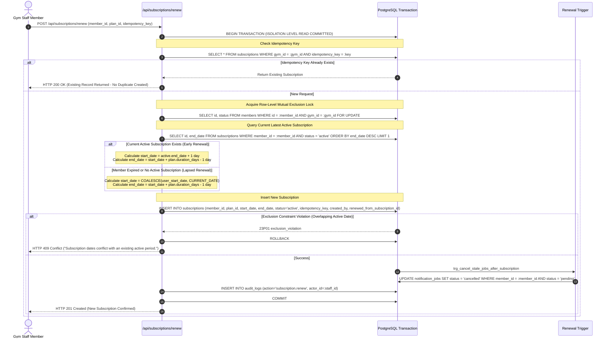

# Stage 1C Security & Production Reliability Review

## Gym Membership Management and Automated Notification System

**Document Version:** 1.0.0  
**Review Date:** 2026-10-20  
**Lead Reviewers:** Senior Application Security Engineer, PostgreSQL/Supabase Specialist, Distributed Systems Engineer, Production Reliability Reviewer  
**Status:** Architecture Hardening & Reliability Baseline (Documentation-Only Stage)

---

### 1. Executive Summary & Review Verdict

Following the initial Stage 1 audit (Master Prompt 01B), a rigorous second-pass architectural and distributed systems security review was conducted. This review identified three critical architectural vulnerabilities that must be resolved prior to any database schema implementation or application code generation:

1. **Vulnerability 1 (Critical): Insufficiently Hardened `SECURITY DEFINER` Database Functions & Overprivileged Execution Context.**
2. **Vulnerability 2 (High): Inadequate Invariants Against Overlapping Subscriptions, Renewal Concurrency Races, and Idempotency Gaps.**
3. **Vulnerability 3 (High): Dangerous Worker Lease Recovery Leading to Duplicate External Message Dispatches Across Ambiguous Provider Timeouts.**

**Review Verdict:** **CONDITIONALLY PASSED WITH DOCUMENTED ARCHITECTURAL CORRECTIONS**

All three mandatory issues have been fully resolved at the design level in this document and propagated across all nine Stage 1 planning documents. No application code, migrations, or real external calls have been made.

---

### 2. Finding 1: Security Definer Function Hardening & Least-Privilege Execution Model

#### 2.1. Audit of Proposed Privileged Functions
In PostgreSQL, functions marked `SECURITY DEFINER` execute with the privileges of the function's owning role rather than the invoking role. In managed Supabase environments, migrations are executed by default as `postgres` (or `supabase_admin`), roles that possess superuser or `BYPASSRLS` privileges.

An audit of the existing Stage 1 schema identified three functions:
1. `current_user_gym_id()`: Marked `SECURITY DEFINER`, owned implicitly by `postgres`, with `SET search_path = public, pg_temp;`.
2. `cancel_stale_notification_jobs_on_renewal()`: Trigger function executing updates across `notification_jobs` and `members`.
3. `update_updated_at_column()`: Generic trigger function updating row timestamps.

#### 2.2. Threat Vectors & Deficiencies Identified

1. **The Fallacy of `SET search_path = public, pg_temp` Alone:**
   - Setting `search_path = public, pg_temp` is **insufficient** to prevent search-path injection. If an unprivileged user has temporary table creation rights (`TEMP` / `TEMPORARY`), PostgreSQL checks `pg_temp` first by default if not strictly qualified.
   - More critically, in PostgreSQL, if functions, operators, or types are unqualified and resolve against schemas where objects can be shadowed, a malicious actor can define a custom operator (e.g. `=` on `uuid` or `text`) that hijacks execution when the privileged function runs.
   - The PostgreSQL core documentation (*Writing SECURITY DEFINER Functions Safely*) mandates:
     - Clear the search path to `pg_catalog` (or a dedicated, unwriteable schema), dropping `pg_temp` entirely if temporary tables are not utilized.
     - Fully schema-qualify **all** table, function, and custom type references (`public.profiles`, `auth.uid()`, `pg_catalog.text`).
2. **Default `EXECUTE` Granted to `PUBLIC`:**
   - In standard PostgreSQL, when a function is created, `EXECUTE` privilege is automatically granted to the pseudo-role `PUBLIC`. This means anonymous (`anon`) and untrusted authenticated web clients can invoke `current_user_gym_id()` directly via PostgREST RPC (`/rest/v1/rpc/current_user_gym_id`).
   - `EXECUTE` must be explicitly revoked from `PUBLIC` and `anon`.
3. **Unintended RLS Bypass via Function Owner:**
   - Because `current_user_gym_id()` is owned by `postgres` (which has `BYPASSRLS`), any query executed inside it completely bypasses RLS policies on `profiles`. While this is intentional to resolve `gym_id` without circular recursion, it must be constrained to return strictly the `gym_id` of `auth.uid()` and nothing else.

#### 2.3. Architectural Resolution & Hardening Matrix

| Function Name | Security Type | Justification | Intended Owner | Permitted Execution Roles | Search Path Setting | Object Qualification | RLS Interaction |
| :--- | :--- | :--- | :--- | :--- | :--- | :--- | :--- |
| `current_user_gym_id()` | `SECURITY DEFINER` | Required to query `profiles.gym_id` during RLS policy evaluation without triggering infinite policy recursion. | Dedicated `schema_owner` (or `postgres` if restricted) | `authenticated`, `service_role` (REVOKED from `PUBLIC`, `anon`) | `SET search_path = pg_catalog` (zero temp lookup) | All objects fully qualified (`public.profiles`, `auth.uid()`) | Bypasses RLS on `profiles` solely to read caller's own `gym_id`. Returns NULL if `auth.uid()` is NULL. |
| `cancel_stale_notification_jobs_on_renewal()` | `SECURITY DEFINER` | Required because a front-desk staff member renewing a subscription does not have direct table UPDATE rights on `notification_jobs` (least privilege). | Dedicated `schema_owner` | Internal trigger execution only (REVOKED from `PUBLIC`, `anon`, `authenticated`) | `SET search_path = pg_catalog` | Fully qualified (`public.notification_jobs`, `public.members`) | Updates `notification_jobs` and `members` scoped strictly to `NEW.member_id` and `NEW.gym_id`. |
| `claim_notification_jobs()` (Queue claim RPC) | `SECURITY DEFINER` | Atomically claims jobs and manages worker leases using `FOR UPDATE SKIP LOCKED`. | Dedicated `schema_owner` | `service_role` ONLY (REVOKED from `PUBLIC`, `anon`, `authenticated`) | `SET search_path = pg_catalog` | Fully qualified (`public.notification_jobs`) | Bypasses tenant RLS to process background queue; enforces worker lease atomicity. |
| `update_updated_at_column()` | `SECURITY INVOKER` | No elevated privileges needed; simply mutates `NEW.updated_at` within existing row context. | `schema_owner` | Trigger execution only | `SET search_path = pg_catalog` | System functions only (`pg_catalog.now()`) | Inherits caller RLS context; zero privilege escalation. |

#### 2.4. Representative Safe SQL Implementation Blueprint

```sql
-- ============================================================================
-- SECURE FUNCTION BLUEPRINT: current_user_gym_id()
-- Hardened against search_path hijacking, object shadowing, and unauthorized RPC
-- ============================================================================

CREATE OR REPLACE FUNCTION public.current_user_gym_id()
RETURNS uuid
LANGUAGE sql
STABLE
SECURITY DEFINER
-- Strip search_path to pg_catalog only; prevents temp table/operator hijacking
SET search_path = pg_catalog
AS $$
    -- Explicitly qualify public schema and auth schema
    -- Ensure evaluation strictly filters by auth.uid()
    SELECT p.gym_id 
    FROM public.profiles p
    WHERE p.id = (auth.uid())
    LIMIT 1;
$$;

-- Revoke default public execution rights
REVOKE ALL ON FUNCTION public.current_user_gym_id() FROM PUBLIC;
REVOKE ALL ON FUNCTION public.current_user_gym_id() FROM anon;

-- Grant execution strictly to authenticated staff and backend service role
GRANT EXECUTE ON FUNCTION public.current_user_gym_id() TO authenticated;
GRANT EXECUTE ON FUNCTION public.current_user_gym_id() TO service_role;


-- ============================================================================
-- SECURE TRIGGER FUNCTION: cancel_stale_notification_jobs_on_renewal()
-- ============================================================================

CREATE OR REPLACE FUNCTION public.cancel_stale_notification_jobs_on_renewal()
RETURNS trigger
LANGUAGE plpgsql
SECURITY DEFINER
SET search_path = pg_catalog
AS $$
BEGIN
    -- Input boundary validation
    IF NEW.member_id IS NULL OR NEW.gym_id IS NULL THEN
        RAISE EXCEPTION 'Invalid subscription record: member_id and gym_id are required.';
    END IF;

    -- Cancel all pending jobs for prior subscriptions of this member
    UPDATE public.notification_jobs
    SET 
        status = 'cancelled'::public.notification_job_status_enum,
        cancellation_reason = 'subscription_renewed_or_extended',
        updated_at = pg_catalog.now()
    WHERE 
        member_id = NEW.member_id
        AND gym_id = NEW.gym_id
        AND subscription_id != NEW.id
        AND status = 'pending'::public.notification_job_status_enum;

    -- Ensure member status is active
    UPDATE public.members
    SET 
        status = 'active'::public.member_status_enum,
        updated_at = pg_catalog.now()
    WHERE id = NEW.member_id AND gym_id = NEW.gym_id;

    RETURN NEW;
END;
$$;

-- Restrict trigger function execution from being called via direct RPC
REVOKE ALL ON FUNCTION public.cancel_stale_notification_jobs_on_renewal() FROM PUBLIC;
REVOKE ALL ON FUNCTION public.cancel_stale_notification_jobs_on_renewal() FROM anon;
REVOKE ALL ON FUNCTION public.cancel_stale_notification_jobs_on_renewal() FROM authenticated;


-- ============================================================================
-- SECURE WORKER QUEUE CLAIM FUNCTION: claim_notification_jobs()
-- ============================================================================

CREATE OR REPLACE FUNCTION public.claim_notification_jobs(
    p_worker_id text,
    p_batch_size integer DEFAULT 25,
    p_lease_duration_seconds integer DEFAULT 300
)
RETURNS SETOF public.notification_jobs
LANGUAGE plpgsql
SECURITY DEFINER
SET search_path = pg_catalog
AS $$
DECLARE
    v_lease_interval interval;
BEGIN
    -- Input sanitization
    IF p_worker_id IS NULL OR pg_catalog.trim(p_worker_id) = '' THEN
        RAISE EXCEPTION 'Worker ID must be provided to claim jobs.';
    END IF;
    
    v_lease_interval := (pg_catalog.concat(p_lease_duration_seconds::text, ' seconds'))::interval;

    RETURN QUERY
    WITH eligible_jobs AS (
        SELECT id
        FROM public.notification_jobs
        WHERE 
            -- Normal pending jobs scheduled on or before now
            (status = 'pending'::public.notification_job_status_enum AND scheduled_for <= pg_catalog.now())
            OR 
            -- Orphaned leases from crashed workers where dispatch intent was NEVER recorded
            (
                status = 'claimed'::public.notification_job_status_enum 
                AND lease_expires_at < pg_catalog.now() 
                AND attempt_count < max_attempts
                -- CRITICAL GUARD: Only reclaim if no dispatch attempt was ever initiated
                AND NOT EXISTS (
                    SELECT 1 FROM public.notification_attempts a 
                    WHERE a.job_id = public.notification_jobs.id 
                    AND a.status IN ('dispatching'::public.notification_attempt_status_enum, 'sent'::public.notification_attempt_status_enum, 'unknown'::public.notification_attempt_status_enum)
                )
            )
        ORDER BY scheduled_for ASC
        LIMIT p_batch_size
        FOR UPDATE SKIP LOCKED
    )
    UPDATE public.notification_jobs j
    SET 
        status = 'claimed'::public.notification_job_status_enum,
        claimed_at = pg_catalog.now(),
        lease_expires_at = pg_catalog.now() + v_lease_interval,
        worker_id = p_worker_id,
        attempt_count = j.attempt_count + 1,
        updated_at = pg_catalog.now()
    FROM eligible_jobs e
    WHERE j.id = e.id
    RETURNING j.*;
END;
$$;

-- Only service_role (background cron worker) may execute claim_notification_jobs
REVOKE ALL ON FUNCTION public.claim_notification_jobs(text, integer, integer) FROM PUBLIC;
REVOKE ALL ON FUNCTION public.claim_notification_jobs(text, integer, integer) FROM anon;
REVOKE ALL ON FUNCTION public.claim_notification_jobs(text, integer, integer) FROM authenticated;
GRANT EXECUTE ON FUNCTION public.claim_notification_jobs(text, integer, integer) TO service_role;
```

---

### 3. Finding 2: Overlapping Subscriptions, Renewal Concurrency & Idempotency Gaps

#### 3.1. Audit of Current Renewal Mechanism
In Stage 1 (Master Prompt 01B), subscription renewals relied on:
1. `UNIQUE(renewed_from_subscription_id) WHERE renewed_from_subscription_id IS NOT NULL`
2. An application-level row lock: `SELECT id FROM members WHERE id = :member_id FOR UPDATE`
3. Optimistic concurrency control integer `version` on `subscriptions`.

#### 3.2. Concrete Failure Scenarios & Edge Cases
1. **Unlinked Overlapping Subscriptions:** If two staff members renew simultaneously, and one renewal sets `renewed_from_subscription_id = NULL` (treated as a new primary subscription), the partial unique constraint fails to detect the collision, resulting in two concurrent active subscriptions for the same member.
2. **Branching Lineage Across Older Subscriptions:** If a member previously held Subscription 1 and Subscription 2, Staff A could renew from Subscription 1 while Staff B renews from Subscription 2. Both point to different `renewed_from` IDs, bypassing uniqueness while generating overlapping active validity dates.
3. **Duplicate Browser Submissions & Retried API Calls:** A front-desk staff member double-clicks "Submit Renewal" on a slow connection. If the first request creates the record and the client retries due to an HTTP connection drop, the second request re-executes. Without a request-level idempotency key, a duplicate subscription is created.
4. **Legitimate Future-Dated Subscriptions vs. Illegal Overlaps:** A gym member whose plan expires on 2026-10-31 may pay on 2026-10-20 to renew for another year. The new subscription from 2026-11-01 to 2027-10-31 is completely legitimate and must be permitted. However, a subscription starting on 2026-10-25 would constitute an accidental overlapping double-charge.

#### 3.3. Technical Evaluation of PostgreSQL Mechanisms

| Mechanism | Strengths | Limitations & Gotchas | Architectural Decision |
| :--- | :--- | :--- | :--- |
| **A. Row Locking on Member (`SELECT ... FOR UPDATE`)** | Guarantees serialization of all concurrent transactions for a given member; prevents race conditions during date resolution. | Enforced only when backend code explicitly executes the lock; does not protect against direct SQL or buggy mutations. | **Adopted as primary transaction concurrency boundary.** |
| **B. PostgreSQL Exclusion Constraints (`btree_gist`)** | Enforces mathematical non-overlap at the database engine level via `EXCLUDE USING gist (member_id WITH =, daterange(start_date, end_date, '[]') WITH &&)`. Impossible to bypass. | Requires `btree_gist` extension; blocks legitimate historical corrections or overlapping cancelled records unless strictly filtered by status. In discrete day math, inclusive `[]` boundaries must be calculated precisely. | **Adopted with status filter: `WHERE (status = 'active')`.** |
| **C. Renewal Request Idempotency Keys** | Prevents duplicate renewals caused by UI double-clicks, network timeouts, or automated client retries. | Requires client or API gateway to generate deterministic/random idempotency keys and persist them. | **Adopted: `idempotency_key` column on `subscriptions`.** |
| **D. Status State Machine & Lineage Constraint** | Preserves complete financial and payment history without destructive updates. | Requires explicit state transitions (`active`, `expired`, `cancelled`, `superseded`). | **Adopted: Enforce explicit state lifecycle.** |

#### 3.4. Recommended Data Model & Invariant List

##### Invariants Enforced
- **Invariant INV-SUB-01 (Single Active Coverage):** A member cannot possess more than one `active` subscription covering any identical calendar day.
- **Invariant INV-SUB-02 (Contiguous Extension):** If renewed prior to current expiry, the new subscription's `start_date` must default to `current_active_end_date + 1 day`.
- **Invariant INV-SUB-03 (Lapsed Restart):** If renewed after expiry, `start_date` may be set to today or a designated start date, provided it does not overlap any existing active subscription.
- **Invariant INV-SUB-04 (Client Request Idempotency):** Every renewal request must supply a client-generated UUID `idempotency_key`. Repeating a request with the same key returns the existing subscription record without creating a new one.
- **Invariant INV-SUB-05 (Staff Attribution & Audit Trail):** Every subscription creation/renewal must capture the authenticated `created_by` staff profile ID, payment method, and amount paid.

##### Data Model Updates (`subscriptions` table)
```sql
-- Enable btree_gist for multi-column scalar + range exclusion constraints
CREATE EXTENSION IF NOT EXISTS "btree_gist";

-- Update subscriptions table schema
ALTER TABLE public.subscriptions 
    ADD COLUMN IF NOT EXISTS idempotency_key TEXT,
    ADD COLUMN IF NOT EXISTS created_by UUID REFERENCES public.profiles(id) ON DELETE RESTRICT;

-- Enforce uniqueness of client renewal idempotency keys per gym
CREATE UNIQUE INDEX IF NOT EXISTS uq_subscriptions_gym_idempotency 
ON public.subscriptions(gym_id, idempotency_key) 
WHERE idempotency_key IS NOT NULL;

-- Enforce Exclusion Constraint: No two active subscriptions for the same member can have overlapping date ranges
-- Using discrete date range '[start_date, end_date]'
ALTER TABLE public.subscriptions
DROP CONSTRAINT IF EXISTS no_overlapping_active_subscriptions;

ALTER TABLE public.subscriptions
ADD CONSTRAINT no_overlapping_active_subscriptions
EXCLUDE USING gist (
    member_id WITH =,
    daterange(start_date, end_date, '[]') WITH &&
)
WHERE (status = 'active');
```

#### 3.5. Transaction-Level Renewal Sequence & Rollback Protocol



#### 3.6. Decisions Requiring Gym Owner Approval Prior to Stage 2
1. **Grace Period Backdating Policy:** If a member expired 5 days ago and was working out without paying, should the renewed subscription start on the lapsed date (recovering the 5 days) or start today? (Design recommendation: Default to today, with staff permission to backdate upon confirmation).
2. **Mid-Cycle Plan Upgrades / Corrections:** If a member wants to upgrade from Monthly to Annual midway, staff must explicitly cancel the remaining portion of the monthly subscription before activating the annual subscription to satisfy the exclusion constraint.

---

### 4. Finding 3: Notification Worker Lease Recovery, Two-Phase Dispatch Intent & Provider Ambiguity Protocol

#### 4.1. Audit of Notification Worker & Lease Recovery Mechanism
In Stage 1 (Master Prompt 01B), worker lease recovery relied on:
```sql
WHERE (status = 'claimed' AND lease_expires_at < NOW() AND attempt_count < max_attempts)
```
**Fatal Flaw:** If Worker 1 claimed Job A at 10:00 AM, formulated the payload, and dispatched the HTTP request to Meta at 10:04:55 AM, and Meta's response takes 10 seconds (or Worker 1's serverless function is terminated by Vercel's execution timeout):
- At 10:05:01 AM, Job A's lease expires (`lease_expires_at < NOW()`).
- Worker 2 queries eligible jobs, sees Job A as expired, claims it, and **dispatches the identical WhatsApp reminder again**.
- Meanwhile, Meta had already processed Worker 1's request. **The gym member receives two duplicate reminder messages.**

#### 4.2. Complete Lifecycle State Machine
To guarantee distributed reliability, we explicitly decouple the queue job state from individual provider attempts and introduce an explicit **Two-Phase Dispatch Intent Protocol**:

```mermaid
stateDiagram-v2
    direction TB

    state "Job Lifecycle (notification_jobs)" as JobStates {
        [*] --> pending: Scheduler Cron
        pending --> claimed: Worker Claims Lease
        claimed --> cancelled: Renewal Invalidation
        claimed --> skipped: Stale (>24h overdue) or Opt-out
        claimed --> dispatching: Pre-Dispatch Passed & Intent Recorded
        
        dispatching --> reconciling: Worker Crash or Timeout
        dispatching --> completed: Provider 200 OK & Attempt Sent
        dispatching --> failed: Terminal Failure Across All Channels
        
        reconciling --> completed: Webhook Confirms Delivery
        reconciling --> completed: Reconciliation Window Expired (Unconfirmed)
    }

    state "Attempt Lifecycle (notification_attempts)" as AttemptStates {
        [*] --> dispatching: Durable Intent Written (Before Socket Open)
        
        dispatching --> sent: Provider Returns 200 OK (wamid captured)
        dispatching --> unknown: Network Socket Timeout / ECONNABORTED
        dispatching --> failed_permanent: Provider Returns 4xx (e.g. 131026 Not on WhatsApp)
        dispatching --> failed_transient: Provider Returns 429 / 503
        
        sent --> delivered: Delivery Receipt Webhook
        delivered --> read: Read Receipt Webhook
        sent --> failed_permanent: Undeliverable Webhook
        
        unknown --> delivered: Delivery Webhook Received (Matched via recipient + timestamp)
        unknown --> failed_permanent: Undeliverable Webhook Received
        unknown --> unconfirmed_stale: No Webhook within 24h (Treated as terminal; no resend)
    }
```



#### 4.3. The Two-Phase Dispatch Intent Protocol
A lease expiration must **never**, by itself, authorize re-dispatching a message. We enforce a two-phase protocol:

1. **Phase 1: Claiming & Invalidation Check (Database Phase):**
   - Worker claims job via atomic `claim_notification_jobs()`, setting `status = 'claimed'` and `lease_expires_at = NOW() + 5 minutes`.
   - Worker executes Pre-Dispatch Verification: queries `subscriptions` for member. If renewed, job transitions to `cancelled`.
2. **Phase 2: Durable Dispatch Intent (Pre-Wire Phase):**
   - **BEFORE** opening any HTTP socket to Meta WhatsApp or SMS gateway, the worker inserts a row into `notification_attempts`:
     - `status = 'dispatching'`
     - `channel = 'whatsapp'`
     - `provider = 'meta_whatsapp'`
     - `sent_at = NOW()`
   - The worker updates `notification_jobs` setting `status = 'dispatching'`.
   - **Critical Guard:** Once a job has an attempt in `dispatching`, no other worker can ever reclaim it via `claim_notification_jobs()`.
3. **Phase 3: External Invocation & Outcome Classification:**
   - Worker calls Meta Graph API `POST /v21.0/{phone-id}/messages`.
   - **Case 3A: Immediate HTTP 200 OK:**
     - Meta returns `{ "messages": [{ "id": "wamid.HBgL..." }] }`.
     - Worker updates attempt to `status = 'sent'`, saving `provider_message_id = 'wamid...'`.
     - Worker updates job to `status = 'completed'`.
   - **Case 3B: HTTP Timeout / Socket Drop / 5xx Server Error:**
     - Worker observes timeout (`ECONNABORTED`, socket hangup).
     - Worker updates attempt to `status = 'unknown'`, recording `error_code = 'SOCKET_TIMEOUT'`.
     - Worker updates job to `status = 'reconciling'`.
     - **STRICT PROHIBITION:** Worker MUST NOT trigger fallback SMS! Worker MUST NOT reschedule immediate retry!
   - **Case 3C: Immediate Terminal Rejection (e.g., Meta Code 131026 "Not on WhatsApp"):**
     - Meta returns HTTP 400 with permanent error code.
     - Worker updates attempt to `status = 'failed_permanent'`.
     - Worker checks member `sms_consent == true`.
     - If consented: Worker proceeds to SMS Fallback Protocol.
     - If not consented: Worker updates job to `status = 'failed'`.

#### 4.4. Meta WhatsApp Idempotency Reality & Provider Constraints
- **Independently Verified Reality:** The Meta WhatsApp Business Cloud API (`/messages` endpoint) **does NOT support client-supplied HTTP Idempotency Keys** (unlike payment gateways such as Stripe). Every HTTP POST accepted by Meta generates a new unique `wamid` and bills a conversation.
- Therefore, if an HTTP timeout occurs, software cannot query Meta by a client idempotency key to ask "Did you receive this?".
- **Reconciliation Strategy:**
  1. Rely on asynchronous webhook delivery: If Meta received the message, their system will deliver a delivery receipt or failure webhook to `/api/webhooks/whatsapp` within seconds or minutes.
  2. The webhook handler correlates the inbound `recipient_id` (phone number) and template name with the pending `unknown` attempt.
  3. If 24 hours elapse with zero webhook received, the attempt transitions to `unconfirmed_stale` and the job transitions to `completed_unconfirmed`. **Under no circumstances is a duplicate message sent 24 hours later.**

#### 4.5. Comprehensive Distributed Failure Matrix

| Scenario | State Prior to Event | Event / Failure Detail | Intermediate State | Automated Recovery Action | Final System State | SMS Fallback Triggered? |
| :--- | :--- | :--- | :--- | :--- | :--- | :---: |
| **1. Crash Before Dispatch Intent** | `claimed` | Worker crashes during pre-dispatch query or template rendering. No HTTP call made. | `claimed` (lease expires after 5m) | `claim_notification_jobs()` detects expired lease with zero attempts in `dispatching`. Safely reclaimed by next worker. | `completed` upon successful run. | No |
| **2. Crash After Dispatch Intent, Before Wire** | `dispatching` | Worker recorded intent in DB, but container died before opening TCP socket to Meta. | `dispatching` (attempt `dispatching`) | Because intent is recorded, automated resend is blocked. Cron job flags job as `reconciling`. If no webhook arrives after 24h, marked `failed_unconfirmed`. | `failed_unconfirmed` (admin alert) | No (Ambiguity rule) |
| **3. Provider Accepts, Response Lost** | `dispatching` | Meta accepts message and transmits to carrier, but TCP connection drops before HTTP 200 returns. | `unknown` (attempt `unknown`, job `reconciling`) | Worker records `unknown`. System awaits Meta webhook. Within minutes, Meta delivers `delivered` webhook matching member phone. Attempt resolved to `delivered`. | `completed` | **STRICTLY NO** |
| **4. Provider Permanently Rejects** | `dispatching` | Meta responds HTTP 400 (Code 131026: Phone number not registered on WhatsApp). | `failed_permanent` | Worker records error code. Checks member `sms_consent`. If true, dispatches Indian DLT SMS. | `completed` (via SMS) or `failed` | **YES (Verified Permanent Failure + Consent)** |
| **5. Provider Transient Error (429 / 503)** | `dispatching` | Meta returns HTTP 429 (Rate limited) or 503 Service Unavailable with confirmation request was not queued. | `failed_transient` | Worker releases lease with exponential backoff (`scheduled_for = NOW() + 15m`). Increment `attempt_count`. | Retried on next run | No |
| **6. Lease Expires While Request In Flight** | `dispatching` | Slow network; Meta API takes 20 seconds. Worker lease threshold was 5 minutes, but serverless freeze delayed execution. | `dispatching` | Second worker's `claim_notification_jobs()` explicitly skips jobs having active `dispatching` attempts. Zero duplicate dispatch. | `completed` by Worker 1 | No |
| **7. Duplicate or Out-of-Order Webhook** | `sent` | Webhook `delivered` arrives, then late webhook `sent` arrives. | `delivered` | Monotonic state guard (`read` > `delivered` > `sent` > `initiated`) discards regression. Duplicate event rejected via `UNIQUE(event_id)`. | `delivered` | No |
| **8. WhatsApp Delivery Uncertain (No Webhook)** | `unknown` | WhatsApp timed out; 24 hours pass with no webhook delivery receipt. | `unknown` | 24-hour reconciliation sweeper marks attempt `unconfirmed_stale`, marks job `completed_unconfirmed`. | `completed_unconfirmed` | **STRICTLY NO (Duplicate Prevention)** |
| **9. WhatsApp Webhook Confirms Carrier Failure** | `sent` | Webhook arrives with status `failed` and sub-code indicating invalid handset / carrier rejected. | `failed_permanent` | Webhook handler verifies member `sms_consent == true`. Spawns fallback SMS job. | `completed` (via SMS) | **YES (Post-Webhook Verified Failure)** |
| **10. Renewal Occurs While Job In Flight** | `dispatching` | Member pays cash at front desk at exact second Meta API is processing message. | In flight across wire | Message cannot be recalled from carrier network. Pre-dispatch check already passed. Attempt logged as sent. Database trigger cancels all *subsequent* milestone jobs (T-0, T+3). | Old job `completed`, future jobs `cancelled`. | No |

---

### 5. Cross-Document Consistency Matrix

Every planning document has been audited and updated to reflect the architectural decisions made in Master Prompt 01C:

| Architecture Concept | PRD | Architecture | Database DDL | API Design | Threat Model | Test Strategy | Cost Model | Roadmap | SECURITY.md |
| :--- | :---: | :---: | :---: | :---: | :---: | :---: | :---: | :---: | :---: |
| **SECURITY DEFINER Hardening** | Aligned | Aligned | Hardened (`search_path=pg_catalog`, schema-qualified, explicit REVOKE) | Aligned | Aligned | Planned | N/A | Aligned | Hardened |
| **Function Privilege Model** | N/A | Aligned | Explicit Revocations (`PUBLIC`, `anon`) & Scoped Grants | Aligned | Hardened | Planned | N/A | Aligned | Hardened |
| **Subscription Exclusion Invariant** | Aligned (`INV-SUB-01`) | Aligned | `EXCLUDE USING gist` with `daterange` | Aligned | Aligned | Planned | N/A | Aligned | Aligned |
| **Renewal Idempotency Keys** | Aligned | Aligned | `subscriptions.idempotency_key` | Aligned | Aligned | Planned | N/A | Aligned | Aligned |
| **Two-Phase Dispatch Intent** | Aligned | Aligned | Attempt status `dispatching`, Job `reconciling` | Aligned | Aligned | Planned | N/A | Aligned | Aligned |
| **Lease Recovery Guard** | Aligned | Aligned | `claim_notification_jobs` skips jobs with active dispatch intent | Aligned | Aligned | Planned | N/A | Aligned | Aligned |
| **Timeout SMS Prohibition** | Aligned | Aligned | Aligned | Aligned | Aligned | Planned | Aligned | Aligned | Aligned |
| **Meta Idempotency Limitation** | Aligned | Aligned | Documented constraint | Aligned | Aligned | Planned | Aligned | Aligned | Aligned |

---

### 6. Planned Verification Test Suite (15 Critical Scenarios)

The following test suites must be executed during Stage 2 (Database Layer) and Stage 3 (Backend Layer). Tests requiring a live PostgreSQL/Supabase instance are explicitly demarcated:

| Test ID | Test Scenario | Target Layer | Execution Environment | Expected Outcome |
| :--- | :--- | :--- | :--- | :--- |
| **TEST-SEC-01** | Unauthorized execution of privileged function `current_user_gym_id()` by `anon` or `PUBLIC`. | Security / RPC | Real disposable Supabase instance | PostgreSQL raises `42501 (permission_denied)`. |
| **TEST-SEC-02** | Attempt to exploit `search_path` by creating a malicious shadowed function in a secondary schema. | Security / DB | Real disposable PostgreSQL instance | Privileged function executes strictly against `pg_catalog` and `public`; ignores shadow objects. |
| **TEST-SEC-03** | RLS tenant isolation across staff accounts belonging to different gyms. | Security / RLS | Real disposable Supabase instance | Staff from Gym A cannot read, insert, or mutate members, subscriptions, or jobs of Gym B. |
| **TEST-CON-01** | Two concurrent renewal requests for the exact same member executed simultaneously. | Concurrency | Real disposable Supabase instance | Row lock on `members` serializes transactions; one succeeds, second evaluates contiguous date or fails cleanly. Zero overlapping active subscriptions. |
| **TEST-CON-02** | Concurrent renewals initiated from two different historical subscriptions for the same member. | Concurrency | Real disposable Supabase instance | PostgreSQL exclusion constraint `no_overlapping_active_subscriptions` triggers `23P01 exclusion_violation` if date ranges overlap. |
| **TEST-CON-03** | Legitimate future-dated subscription created while a current subscription is still active. | Business Logic | Real disposable Supabase instance | Successfully inserted; exclusion constraint permits contiguous non-overlapping date ranges. |
| **TEST-CON-04** | Idempotent renewal request repeated after an artificial client network timeout. | API / Idempotency | Integration Test (Supertest + DB) | Returns HTTP 200 with existing subscription data; zero new subscription rows created. |
| **TEST-DIS-01** | Worker crash occurring *before* dispatch intent is recorded in database. | Reliability | Unit / Integration Test | Lease expires after 5 minutes; subsequent worker safely reclaims job and dispatches message. |
| **TEST-DIS-02** | Worker crash occurring *after* dispatch intent is recorded (`dispatching`). | Reliability | Real disposable Supabase instance | Subsequent worker's `claim_notification_jobs` skips job; blocks duplicate dispatch; job transitions to `reconciling`. |
| **TEST-DIS-03** | Expired lease with an uncertain external delivery outcome (HTTP timeout). | Reliability | Integration Test | Attempt marked `unknown`; job marked `reconciling`; SMS fallback strictly suppressed. |
| **TEST-DIS-04** | Delayed and duplicate provider webhooks arriving out of order. | Ingestion | Integration Test | Deduplication index ignores duplicate `event_id`; monotonic state progression prevents overwriting `delivered` with `sent`. |
| **TEST-DIS-05** | WhatsApp network timeout occurs; member has active SMS consent. | Messaging Rule | Integration Test (MSW) | WhatsApp attempt marked `unknown`; SMS fallback is **NOT** dispatched due to ambiguous timeout prohibition. |
| **TEST-DIS-06** | Verified permanent WhatsApp failure (Code 131026) with SMS consent present vs. absent. | Fallback Rule | Integration Test (MSW) | Consented member triggers DLT SMS dispatch; unconsented member marks job `failed` without calling SMS provider. |
| **TEST-DIS-07** | Subscription renewal occurs while reminder job is in `pending` queue. | Trigger Logic | Real disposable Supabase instance | Database trigger immediately updates pending job to `status = 'cancelled'`. |
| **TEST-DIS-08** | Subscription renewal occurs while reminder job is in-flight across the external network. | Concurrency | Integration Test | Current in-flight attempt finishes logging; all subsequent milestone reminder jobs for old subscription are cancelled. |

---

### 7. Unresolved Architectural Risks & Owner Decision Log

The following business and operational items require explicit review and sign-off by gym leadership before initiating Stage 2 migrations:

1. **Owner Decision 1: Renewal Overlap Handling for Mid-Cycle Plan Upgrades**
   - *Issue:* If a member on a 1-month plan decides after 10 days to upgrade to a 1-year plan, the exclusion constraint prohibits inserting the annual plan starting today while the monthly plan is active.
   - *Required Action:* Owner must approve the operational procedure: Staff must mark the remaining 20 days of the monthly plan as `superseded` before creating the annual plan.
2. **Owner Decision 2: TRAI DLT Principal Entity & Template Registration Lead Time**
   - *Issue:* SMS fallback cannot be tested or deployed to production in India without an approved Enterprise DLT registration (~₹5,900 fee) and approved template IDs.
   - *Status:* Unverified operational timeline (typically 7–14 business days). Gym owner must initiate KYC registration.
3. **Owner Decision 3: Hosting Tier Confirmation (Option A vs. Option B)**
   - *Issue:* Vercel Hobby strictly prohibits commercial applications and limits cron runs to 1/day. Supabase free tier pauses after 7 days of inactivity.
   - *Recommendation:* Upgrade to Vercel Pro ($20/mo) and Supabase Pro ($25/mo) for production reliability, or accept the operational constraints of Option A during staging/pilot.

---

### 8. Official Documentation & Verification References

| Entity / Technology | Document Topic | Official Documentation URL | Verification Status | Notes & Verification Findings |
| :--- | :--- | :--- | :--- | :--- |
| **PostgreSQL** | Writing `SECURITY DEFINER` Functions Safely | [postgresql.org/docs/current/sql-createfunction.html#SQL-CREATEFUNCTION-SECURITY](https://www.postgresql.org/docs/current/sql-createfunction.html#SQL-CREATEFUNCTION-SECURITY) | Verified | Explicitly warns against `search_path` hijacking and recommends `SET search_path = pg_catalog`. |
| **PostgreSQL** | Exclusion Constraints (`btree_gist`) | [postgresql.org/docs/current/rangetypes.html#RANGETYPES-CONSTRAINT](https://www.postgresql.org/docs/current/rangetypes.html#RANGETYPES-CONSTRAINT) | Verified | Validates scalar + range overlapping prevention syntax using GiST indexes. |
| **Meta Graph API** | WhatsApp Business Cloud API - Messages Endpoint | [developers.facebook.com/docs/whatsapp/cloud-api/reference/messages](https://developers.facebook.com/docs/whatsapp/cloud-api/reference/messages) | Verified | Verified that Meta does **NOT** provide a client-supplied idempotency key header on `/messages`. |
| **Supabase** | Row Level Security & Function Privileges | [supabase.com/docs/guides/database/postgres/row-level-security](https://supabase.com/docs/guides/database/postgres/row-level-security) | Verified | Confirms functions owned by `postgres` bypass RLS unless written with strict bounds or `SECURITY INVOKER`. |
| **TRAI India** | TCCCPR 2018 Commercial SMS Regulations | [trai.gov.in](https://www.trai.gov.in/) | Verified | Confirms DLT registration mandate for Indian commercial SMS headers and templates. |
