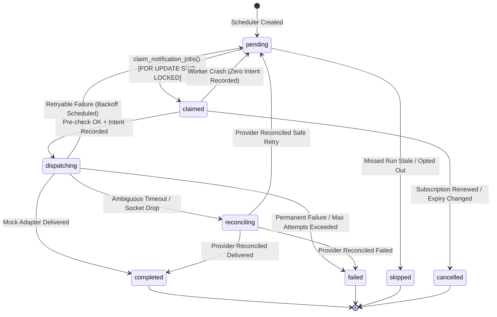

# Stage 5A Reminder Engine Architecture & Design Specification

## Gym Membership Management and Automated Notification System

**Document Version:** 1.0.0  
**Date:** 2026-10-20  
**Status:** Approved & Implemented  
**Scope:** Stage 5A Database-Backed Reminder Engine (Scheduling, Claiming, State Machine, Reconciliation & Local Mock Delivery)

---

### 1. Executive Summary

Stage 5A implements the core database-backed reminder engine for the FITFUSION Gym Membership Management System. The engine guarantees reliable, calendar-accurate scheduling and execution of membership expiry notifications across three mandatory milestones relative to subscription expiry dates.

In accordance with strict safety boundaries:
- **No external messages are transmitted**; a typed `MockDeliveryAdapter` processes dispatches locally for testing and development.
- **Zero remote Supabase connections** or cloud deployments were initiated.
- **Strict two-phase dispatch intent** prevents double-sends upon carrier socket timeouts or worker restarts.
- **Comprehensive calendar arithmetic** replaces floating hourly offsets, deterministically handling leap years, month boundaries, and inclusive expiry dates.

---

### 2. Milestone Definitions & Calendar Date Semantics

Reminders are anchored to the subscription's authoritative `end_date` (inclusive expiration date):

| Milestone Code | Logical Meaning | Calendar Formula | Description |
| :--- | :--- | :--- | :--- |
| `EXPIRY_MINUS_3` | Pre-Expiry Warning | `end_date - 3 calendar days` | First notification alerting member of upcoming expiry |
| `EXPIRY_ZERO` | Day of Expiry | `end_date` (Same calendar date) | Expiry day notification encouraging immediate continuity |
| `EXPIRY_PLUS_3` | Post-Expiry Grace | `end_date + 3 calendar days` | Grace period follow-up before account transitions or deactivation |

#### Exact Date Rules:
1. **Inclusive Expiry Rule:** A subscription with `end_date = '2026-10-25'` is active through `23:59:59.999` of that local calendar date. The member becomes expired only at `00:00:00` on `2026-10-26`.
2. **Calendar-Based Math (Non-Floating):** Calculations operate on integer calendar days (`addCalendarDays`), never on floating 72-hour intervals. For example:
   - Month Boundary: `2026-03-01` minus 3 days = `2026-02-26` (Standard year).
   - Leap Year: `2024-03-01` minus 3 days = `2024-02-27` (Leap year with Feb 29).
   - Year Boundary: `2027-01-02` minus 3 days = `2026-12-30`.
3. **Timezone & Conversion:**
   - Default timezone: `Asia/Kolkata` (UTC +05:30), configured per gym in `gym_settings.timezone`.
   - Send hour: `gym_settings.reminder_send_hour` (default `10`, representing 10:00 AM local time).
   - Target date `2026-10-22` with send hour `10:00 AM IST` maps deterministically to `2026-10-22T04:30:00.000Z`.

---

### 3. Idempotency & Missed-Run Policy

#### Deterministic Idempotency Key
Every reminder job is assigned a unique, immutable idempotency key:
```
rem:${subscription_id}:${milestone}:${target_date}
```
*Example:* `rem:ab71eed9-e576-4f96-8494-d5963ee5fb60:EXPIRY_MINUS_3:2026-10-22`

Enforced by PostgreSQL unique index `notification_jobs(idempotency_key)`. Repeated scheduler runs execute `ON CONFLICT (idempotency_key) DO NOTHING`, ensuring that duplicate jobs are never created.

#### Missed Scheduler Run Policy
If a scheduled execution was delayed (e.g. system downtime or delayed cron trigger) and multiple past milestones are detected:
- **Zero-Burst Invariant:** The system **never sends an overdue burst of notifications** (e.g. sending "expires in 3 days" and "expired 3 days ago" simultaneously).
- Any milestone whose `target_date` is older than the configured grace window (`current_date - 1 calendar day`) is automatically marked with `status = 'skipped'` and `cancellation_reason = 'scheduler_missed_milestone_stale'`.
- Only milestones currently within the active delivery window are queued for dispatch.

---

### 4. Job State Machine & Lifecycle

The reminder job state machine governs all lifecycle transitions:



#### State Definitions:
- **`pending`**: Scheduled and awaiting execution time (`scheduled_for <= NOW()`).
- **`claimed`**: Claimed by an active worker under a short-lived lease (`lease_expires_at = NOW() + 300s`).
- **`dispatching`**: Pre-dispatch eligibility confirmed and durable dispatch intent recorded in `notification_attempts`.
- **`completed`**: Delivery successfully confirmed by adapter; marked with `processed_at`.
- **`failed`**: Terminal failure (invalid mobile recipient, carrier rejection, or `attempt_count >= max_attempts`).
- **`skipped`**: Ineligible due to regulatory consent opt-out or missed scheduler run.
- **`cancelled`**: Prior subscription renewed, extended, or cancelled before dispatch.
- **`reconciling`**: Upstream network dropped during transmission; held in quarantine pending out-of-band receipt verification.

---

### 5. Multi-Layer Eligibility Verification

Eligibility is validated at two distinct checkpoints:

#### Checkpoint 1: Scheduling-Time Eligibility
- Subscription has `status = 'active'`.
- Member has `status != 'archived'`.
- Subscription has not been superseded (`renewed_from_subscription_id` is not referenced by a newer active subscription).
- Member has consented to at least one delivery channel (`whatsapp_consent` or `sms_consent`).

#### Checkpoint 2: Immediate Pre-Dispatch Eligibility
Executed immediately before delivery adapter invocation:
1. Referenced subscription still exists in the database.
2. Subscription status is not `'cancelled'` or `'superseded'`.
3. **Expiry Date Invariant:** The subscription's current `end_date` must still match the expected target date calculation. If the member extended or renewed their membership, the job is cancelled with reason `'subscription_expiry_date_changed'`.
4. Member remains unarchived and has not revoked channel consent.
5. Job has not already completed or been cancelled by another worker.

---

### 6. Concurrency, Leases & Two-Phase Dispatch Guard

#### Atomic Claiming via PostgreSQL
Workers claim batches using `claim_notification_jobs(p_worker_id, p_batch_size, p_lease_duration_seconds)`:
- Uses `FOR UPDATE SKIP LOCKED` to prevent lock contention across concurrent worker processes.
- Assigns ownership to `worker_id` and sets `lease_expires_at = NOW() + INTERVAL '300 seconds'`.
- Increments `attempt_count`.

#### Two-Phase Dispatch Guard
To prevent duplicate messages when an external provider call times out:
1. **Phase 1 (Durable Intent):** Before initiating network communication, an attempt record with `status = 'dispatching'` is committed to `public.notification_attempts`.
2. **Phase 2 (Adapter Invocation):** The delivery adapter is invoked.
3. **Lease Sweeper Protection:** If a worker crashes, `sweepExpiredLeases()` checks if a dispatch intent exists. If no attempt exists, the lease is safely reset to `pending`. If an intent exists, the job transitions to `reconciling` rather than re-dispatching blindly.

---

### 7. Retry Policy & Exponential Backoff

For transient failures (e.g. temporary gateway rate limits):
- **Attempt 1:** Backoff 60 seconds (`scheduled_for = NOW() + 60s`).
- **Attempt 2:** Backoff 300 seconds (5 minutes).
- **Attempt 3:** Backoff 900 seconds (15 minutes).
- **Max Attempts:** 3. Upon exceeding 3 attempts, the job transitions to `failed` with reason `'max_attempts_exceeded'`.

---

### 8. Database Architecture & Additive Migration 004

Implemented in `supabase/migrations/20261020000004_reminder_engine_optimizations.sql`:
1. `idx_subscriptions_active_end_date`: Compound index on `(gym_id, status, end_date) WHERE status = 'active'` for high-speed scheduler queries.
2. `idx_jobs_sub_milestone`: Compound index on `(subscription_id, milestone)` for rapid renewal invalidation checks.
3. `idx_jobs_gym_target_date`: Index on `(gym_id, target_date, status)` for administrative queries.
4. `safe_complete_notification_job(p_job_id, p_worker_id)`: Atomic SQL function enforcing worker lease ownership before marking a job `completed`.
