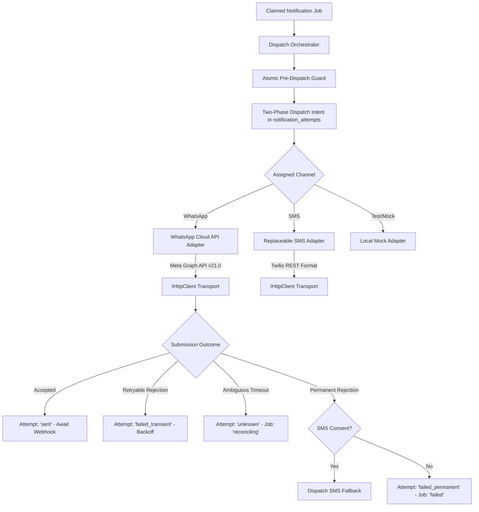

# Stage 5B: Messaging Provider Architecture & Integration Design

**System:** FITFUSION Gym Membership Management System  
**Stage:** Stage 5B — Safe, Testable Messaging Provider Integration (Zero Live Sends)  
**Workspace:** `D:\PROJECT\GYM MANGEMENT SYSTEM`  
**Date:** 2026-10-20  
**Author:** Senior Backend & Messaging Security Engineer  

---

## 1. Executive Summary

Stage 5B implements a secure, testable, provider-neutral messaging integration architecture on top of the Stage 5A reminder engine foundation. It incorporates:
1. **WhatsApp Business Platform Cloud API Adapter:** Formats pre-approved business-initiated template messages conforming to Meta Graph API v21.0.
2. **Replaceable SMS Provider Adapter:** Abstracted interface supporting standard REST SMS submission (e.g. Twilio / Indian DLT Gateway).
3. **Preserved Local Mock Adapter:** Marked explicitly with `is_mock: true` and provider `'local_mock_adapter'`.
4. **Cryptographic Webhook Foundation:** Enforces HMAC-SHA256 signature verification (`X-Hub-Signature-256`) on incoming Meta webhooks, with idempotency guards and out-of-order event protection.
5. **Strictly Conditional SMS Fallback Orchestrator:** Implements DPDP regulatory consent enforcement. Fallback to SMS is **only** triggered after a confirmed permanent WhatsApp delivery failure; it is strictly prohibited on ambiguous timeouts or temporary errors.
6. **Zero Live Message Transmission:** All tests execute in-process with dependency-injected mock HTTP clients. Zero external network sockets or third-party cloud credentials are required.

---

## 2. Provider-Neutral Architecture & Contracts

The architecture isolates carrier/provider protocols behind typed contracts in `server/services/reminders/providerTypes.ts`:

### Core Lifecycle Data Types

1. **`ProviderSubmissionOutcome`**:
   - `'accepted'`: Provider gateway accepted the message for delivery (assigned `providerMessageId`, e.g. `wamid.HB...`). **Crucial Invariant:** Acceptance is NOT delivery proof.
   - `'retryable_rejection'`: Gateway busy, rate-limited (HTTP 429), or transient 5xx error. Safe to retry with exponential backoff.
   - `'permanent_rejection'`: Unallocated phone number, invalid recipient, unapproved template, or permission denied.
   - `'ambiguous_timeout'`: Network socket dropped or request timed out after dispatch. State is uncertain; **must transition to reconciling and NEVER retry automatically**.

2. **`DeliveryEventStatus` (Inbound Webhooks)**:
   - `'sent'`: Message accepted upstream by carrier.
   - `'delivered'`: Handset received notification.
   - `'read'`: Handset opened notification.
   - `'failed'`: Carrier bounce or handset unreachable.
   - `'undeliverable'`: Expired in transit.

---

## 3. WhatsApp Business Cloud API Adapter

- **Conformity:** Official Meta Graph API v21.0 (`https://graph.facebook.com/v21.0/{phone_number_id}/messages`).
- **Template Messaging:** Outside the 24-hour customer care window, Meta mandates pre-approved template messages. The adapter formats body parameter components containing:
  - `member_name`
  - `expiry_date`
  - `plan_name`
  - `gym_name`
- **Phone Normalization:** Uses `normalizeE164Phone` to ensure phone numbers conform to E.164. Meta's `to` parameter is formatted with international digits without the leading `+` (e.g. `919876543210`). Malformed numbers are rejected with `permanent_rejection` before contacting the gateway.
- **Dependency Injection:** Uses `IHttpClient` interface (`post(url, options)`). In unit and integration tests, a controllable mock transport is injected, ensuring **zero network calls**.
- **Secret Redaction:** Logs and error messages scrub Bearer tokens (`Bearer [REDACTED]`) and mask recipient phone numbers (`+9198****3210`).

---

## 4. SMS Provider Adapter

- **Interface:** `ISmsProviderAdapter` (implements `IProviderAdapter` with `channel: 'sms'`).
- **Standard Protocol:** Formats standard REST SMS payloads (`To`, `From`, `Body`).
- **Replaceability:** Decoupled from specific vendor libraries; easily swappable between Twilio, Fast2SMS, Gupshup, or AWS SNS.
- **Error Mapping:** Maps provider error codes (e.g., Twilio 21211 invalid phone, 21614 non-mobile landline, 21408 permission denied, 429 rate limit) to standard neutral outcomes.

---

## 5. Webhook Foundation & Cryptographic Security

### A. Subscription Handshake (GET `/api/webhooks/whatsapp`)
- Verifies `hub.mode === 'subscribe'` and `hub.verify_token === config.whatsapp.verifyToken`.
- Responds with `hub.challenge` on match; returns HTTP 403 on mismatch.

### B. Event Signature Verification (POST `/api/webhooks/whatsapp`)
- Header: `X-Hub-Signature-256: sha256=<hex_hmac>`.
- Calculates HMAC-SHA256 of raw request bytes using `config.whatsapp.appSecret`.
- Compares signatures using constant-time `crypto.timingSafeEqual`.
- Rejects unauthenticated or tampered payloads with HTTP 401 Problem Details.

### C. Idempotency & Out-of-Order Event Protection
- **Idempotency:** Every incoming event is hashed or keyed by `${provider}:${providerMessageId}:${status}:${timestamp}` and recorded in `webhook_events`. Duplicate events are skipped cleanly without double processing.
- **Out-of-Order Hierarchy:** Uses strict state ranking:
  $$\text{initiated (1)} < \text{dispatching (2)} < \text{sent (3)} < \text{delivered (4)} < \text{read (5)}$$
  If a message was already confirmed `delivered` or `read`, a delayed `sent` webhook arriving out of order will **never** downgrade the attempt status.

---

## 6. Strictly Conditional SMS Fallback Orchestrator

The fallback orchestrator (`dispatchOrchestrator.ts`) enforces strict regulatory and operational boundaries:

1. **Only on Confirmed Permanent WhatsApp Failure:**
   - Permitted: WhatsApp permanent API rejection (e.g. Meta code 131030 invalid recipient) or incoming webhook with status `'failed'`.
   - **Forbidden:** Ambiguous timeouts, network drops, rate limits, or transient 5xx errors **never** trigger SMS fallback.
2. **Explicit Regulatory Consent Required:**
   - Fallback checks `members.sms_consent`. If `sms_consent === false` or member is `archived`, fallback is blocked, and the job transitions to `failed` (`cancellation_reason = 'whatsapp_permanent_failure_no_sms_consent'`).
3. **Audit Trail:**
   - Every fallback action creates a dedicated row in `notification_attempts` with `channel = 'sms'`, documenting why fallback was initiated.
