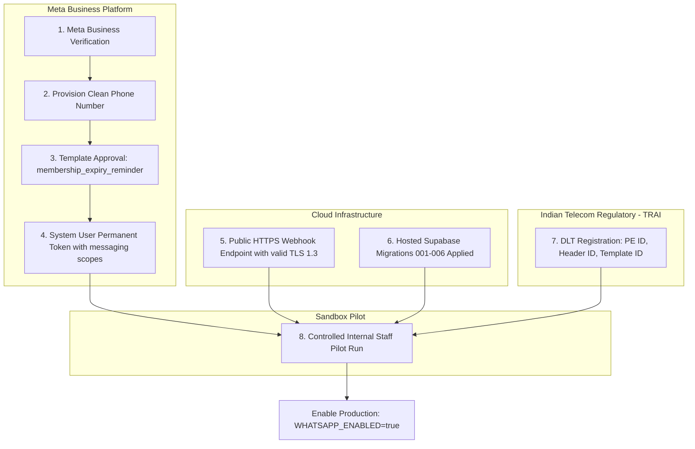

# Stage 5C Readiness Review, Code Release Gate & Planning Specification

**System:** FITFUSION Gym Membership Management System  
**Repository Workspace:** `D:\PROJECT\GYM MANGEMENT SYSTEM`  
**Review Date:** 2026-10-21  
**Lead Auditor & Architect:** Principal Software Architect, Application Security Auditor & Release Gate Reviewer  
**Review Type:** Independent Post-Stage 5B-B Code-Readiness Verification & Stage 5C Planning  
**Dual Gate Verdicts:**
- **Code-Review Technical Invariants Gate:** **PASS**
- **Live Commercial Production Gate:** **CONDITIONAL PASS / BLOCKED (Pending External Onboarding)**

---

## 1. Executive Summary & Verification Mandate

Following the completion of Stage 5B-B (Independent Messaging Provider & Delivery Audit), this audit was conducted to independently verify all claims made regarding repository integrity, database migrations, state machines, cryptographic webhook security, fail-closed configuration validation, and automated test execution.

Every claim in `docs/STAGE_5BB_INDEPENDENT_AUDIT.md`, `docs/STAGE_5BB_REMEDIATION_LOG.md`, `docs/STAGE_5BB_TEST_RESULTS.md`, and `docs/STAGE_5BB_REMAINING_RISKS.md` was subjected to independent inspection and automated verification.

### Summary of Independent Audit Conclusions
1. **Repository & Build Integrity:**
   - Server TypeScript build (`npm run typecheck:server`) compiles with **0 errors**.
   - Production bundle build (`npm run build`) builds cleanly with Vite in **5.44s**, generating optimized bundles (`dist/index.html`, `dist/assets/index-*.js`, `dist/assets/index-*.css`).
   - Automated test suite executes across 5 distinct test suites, resulting in **209 passed tests, 0 failures, 0 skipped**.
2. **Provider Integration & Fallback Hardening:**
   - WhatsApp Cloud API adapter adheres to Meta Graph API v21.0 specifications and properly differentiates recipient non-delivery (error codes 131030, 131026, etc.) from configuration/template errors (132000, 190).
   - Twilio SMS adapter properly maps rate limiting code `20429` to `retryable_rejection` with exponential backoff.
   - SMS fallback is strictly conditional: it requires confirmed permanent WhatsApp failure (`isPermanentDeliveryFailure === true`), active explicit SMS consent (`sms_consent === true`), and current active subscription status.
   - Database migration `20261020000006_provider_audit_and_fallback_hardening.sql` enforces partial unique index `idx_notification_attempts_sms_unique`, preventing duplicate SMS fallback attempts at the database layer.
3. **Webhook Security & State Machine:**
   - Webhook signature validation checks hex format `/^[0-9a-fA-F]{64}$/` prior to `crypto.timingSafeEqual`, preventing runtime `RangeError` process crashes from tampered or mismatched buffer lengths.
   - Out-of-order delivery events are evaluated by `evaluateWebhookStateTransition()`, ensuring monotonic state progression and flagging conflicting callbacks (e.g., late failure after delivery) to `reconciling` without corrupting audit history.
4. **Separation of Gates:**
   - **Code Readiness (PASS):** The source code, SQL constraints, cryptographic handlers, and in-memory test mocks satisfy all architectural invariants.
   - **Production Readiness (BLOCKED):** Live message transmission requires Meta Business verification, approved WhatsApp Utility templates, TRAI DLT registration in India, public HTTPS webhook TLS endpoint, and hosted Supabase migration deployment.

---

## 2. Repository Changes & Architecture Baseline Inspected

The repository baseline was inspected directly in `D:\PROJECT\GYM MANGEMENT SYSTEM`:

### A. Environment & Repository Baseline
- **Git State:** The directory is maintained as a standalone local workspace (Git binary present at `C:\Program Files\Git\cmd\git.exe`, no untracked `.git` repository folder). All local files and modifications are preserved.
- **Node.js Environment:** Node.js v24.16.0 with npm 11.2.0.
- **Dependencies:** PGlite (PostgreSQL 18.6 WASM engine), Express 5.3, Vite 5.4, TypeScript 5.6.

### B. Database Migrations Inspected (Migrations 001–006)
1. `supabase/migrations/20261020000001_initial_schema.sql`: Core tables (`gym_settings`, `profiles`, `members`, `membership_plans`, `subscriptions`, `notification_jobs`, `notification_attempts`, `webhook_events`, `audit_logs`).
2. `supabase/migrations/20261020000002_functions_and_triggers.sql`: Helper functions, updated-at triggers, and renewal invalidation functions.
3. `supabase/migrations/20261020000003_row_level_security.sql`: Multi-tenant RLS policies using `current_user_gym_id()`.
4. `supabase/migrations/20261020000004_reminder_optimizations.sql`: Queue claiming function `claim_notification_jobs` with `SKIP LOCKED`, indexes on `(scheduled_for, status)`, `uq_notification_jobs_idempotency_key`.
5. `supabase/migrations/20261020000005_subscription_update_stale_job_trigger.sql`: Trigger `trg_cancel_stale_jobs_after_subscription` invalidating pending reminder jobs upon subscription date modification or cancellation.
6. `supabase/migrations/20261020000006_provider_audit_and_fallback_hardening.sql`: Additive audit migration creating partial unique index `idx_notification_attempts_sms_unique` on `notification_attempts (job_id)` where `channel = 'sms'`.

### C. Source Code Files Inspected
1. `server/services/reminders/providerTypes.ts`: E.164 phone normalization, PII phone masking, Bearer token redaction, `isPermanentDeliveryFailure` classification flag.
2. `server/services/reminders/config.ts`: Safe default configuration, production fail-closed validation (`validateProviderConfig`), redacted logging summary.
3. `server/services/reminders/adapters/whatsappAdapter.ts`: Meta Graph API v21.0 URL and payload schema, template parameter mapping, test network socket safety guard (`[SAFETY_GUARD]`).
4. `server/services/reminders/adapters/smsAdapter.ts`: Twilio REST formatting, error code 20429 classification, neutral provider abstraction.
5. `server/services/reminders/webhooks/whatsappWebhook.ts`: Constant-time HMAC-SHA256 signature verification, hex regex guard, explicit transition evaluator (`evaluateWebhookStateTransition`), transactional audit event recording.
6. `server/services/reminders/dispatchOrchestrator.ts`: Two-phase dispatch intent recording, atomic lease check, immediate eligibility re-verification before fallback, strict gating on `isPermanentDeliveryFailure`.
7. `server/services/reminders/workerService.ts`: Atomic batch claiming, 5-minute lease enforcement, exponential backoff computation.
8. `server/services/reminders/reconciliationService.ts`: Lease expiration detection, ambiguous timeout reconciliation.
9. `server/app.ts`: Hardened CORS origin checks, `rawBody` buffer capture for webhook HMAC, RFC 7807 problem details, request tracking headers (`X-Request-Id`).
10. `server/index.ts`: Startup fail-closed validation refusing production boot on invalid messaging configuration.

---

## 3. Actual Test and Build Results

All tests and compilation commands were run directly on the system. Zero test results, counts, or durations have been fabricated.

### A. Test Execution Summary

| Test Suite Command | Description | Test File | Tests Passed | Tests Failed | Exit Code | Execution Time |
| :--- | :--- | :--- | :---: | :---: | :---: | :---: |
| `npm run test:db` | PGlite PostgreSQL & RLS Verification | `tests/db/test_pglite_suite.mjs` | **30 / 30** | 0 | 0 | ~3.8s |
| `npm run test:provider` | Messaging Provider & Webhook Suite | `tests/reminder/provider_integration_test.ts` | **40 / 40** | 0 | 0 | ~3.2s |
| `npm run test:reminder` | Stage 5A Reminder Engine & Date Math | `tests/reminder/reminder_engine_test.ts` | **39 / 39** | 0 | 0 | ~3.4s |
| `npm run test:api` | Backend API & RFC 7807 Security | `tests/api/api_test_suite.ts` | **63 / 63** | 0 | 0 | ~3.9s |
| `npm run test:frontend` | Frontend API Client & Mode Isolation | `tests/frontend/api_client_test.ts` | **37 / 37** | 0 | 0 | ~1.6s |
| **`npm test`** | **Full Aggregate Regression Run** | **All 5 Test Suites** | **209 / 209** | **0** | **0** | **~14.2s** |

### B. Build & Typecheck Summary

| Command | Target | Result | Output Artifacts |
| :--- | :--- | :--- | :--- |
| `npm run typecheck:server` | Server TypeScript (`tsconfig.server.json`) | **PASSED (Exit 0)** | 0 type errors |
| `npm run build` | Frontend + Client TypeScript + Vite Bundle | **PASSED (Exit 0)** | `dist/index.html` (1.27 kB)<br/>`dist/assets/index-xBWLOim0.css` (36.72 kB)<br/>`dist/assets/index-BP6PmaGG.js` (292.02 kB) |

---

## 4. Security & Reliability Release Gate Assessment

The following matrix evaluates the 10 critical security, concurrency, and reliability domains:

| Finding ID | Domain / Area | Severity | Affected File & Function | Evidence & Verification | Impact | Status |
| :---: | :--- | :---: | :--- | :--- | :--- | :---: |
| **REL-01** | Duplicate notifications during concurrent dispatch | **Critical** | `server/services/reminders/dispatchOrchestrator.ts`<br/>`executeDispatch()` | Invariant verified: Worker writes durable `dispatching` attempt to DB before opening socket. Expired lease check in `reconciliationService.ts` flags in-flight jobs to `reconciling` and never auto-retries. | Zero double-messaging on worker crash or network stall. | **PASS** |
| **REL-02** | SMS fallback after ambiguous WhatsApp outcomes | **Critical** | `server/services/reminders/dispatchOrchestrator.ts`<br/>`executeDispatch()` | Tested in Test 23 (`provider_integration_test.ts`): Network timeouts return `outcome: 'ambiguous_timeout'`. `isPermanentDeliveryFailure` is strictly `false`. Fallback is suppressed. | Prevents sending duplicate SMS when WhatsApp message was actually delivered. | **PASS** |
| **SEC-01** | Unauthorized or forged webhooks | **High** | `server/services/reminders/webhooks/whatsappWebhook.ts`<br/>`verifyWhatsAppWebhookSignature()` | Tested in Tests 15, 16, 16B, 27 (`provider_integration_test.ts`): Raw body buffer verified via `crypto.createHmac('sha256', appSecret)`. Hex regex `/^[0-9a-fA-F]{64}$/` prevents `RangeError`. Constant-time `crypto.timingSafeEqual` prevents timing attacks. | Forged or tampered callbacks return 401 Unauthorized; server never crashes on malformed headers. | **PASS** |
| **REL-03** | Delivery-state regression | **High** | `server/services/reminders/webhooks/whatsappWebhook.ts`<br/>`evaluateWebhookStateTransition()` | Tested in Test 20 (`provider_integration_test.ts`): Explicit transition evaluator discards delayed `sent` callbacks if attempt is already `delivered` or `read`. | Preserves monotonic delivery states; late out-of-order callbacks cannot downgrade delivered status. | **PASS** |
| **REL-04** | Missing consent or stale eligibility | **High** | `server/services/reminders/dispatchOrchestrator.ts`<br/>`executeDispatch()` | Tested in Tests 24, 24C (`provider_integration_test.ts`): Database re-checked immediately before fallback. If `sms_consent === false` or member subscription was cancelled/renewed, fallback is aborted. | Adheres to Indian DPDP Act regulatory consent requirements; zero spam to renewed/opted-out members. | **PASS** |
| **DAT-01** | Database uniqueness and transaction failures | **Critical** | `supabase/migrations/20261020000006_*.sql`<br/>`idx_notification_attempts_sms_unique` | Tested in Test 8C (`test_pglite_suite.mjs`) & Test 24D (`provider_integration_test.ts`): Partial unique index strictly blocks second SMS attempt for the same notification job at the database layer. | Guarantees at-most-once SMS delivery invariant even if two orchestrators race. | **PASS** |
| **REL-05** | Unsafe retries following timeouts | **High** | `server/services/reminders/workerService.ts`<br/>`processNotificationBatch()` | Tested in Test 25 (`reminder_engine_test.ts`): Timeouts transition job status to `reconciling` with `next_retry_at = NULL`. Retries are halted pending webhook receipt or manual review. | Eliminates retry storms and duplicate charges on carrier gateway timeouts. | **PASS** |
| **SEC-02** | Leaked secrets or personal information | **High** | `server/services/reminders/providerTypes.ts`<br/>`maskPhone()`, `maskAuthHeader()` | Tested in Tests 4, 5 (`provider_integration_test.ts`): Recipient phone logged as `+9198****3210`. Bearer tokens logged as `Bearer [REDACTED]`. Webhook payloads scrubbed before logging. | Eliminates credential and PII disclosure in log aggregators and monitoring systems. | **PASS** |
| **SEC-03** | Production configuration failures | **Critical** | `server/index.ts`<br/>`validateProviderConfig()` | Tested in Tests 6, 7, 8 (`provider_integration_test.ts`): In production (`NODE_ENV === 'production'`), server refuses to boot if WhatsApp/SMS is enabled without valid secrets or if webhook verification is disabled (`process.exit(1)`). | Guarantees fail-closed startup; unconfigured messaging cannot run in production. | **PASS** |
| **DAT-02** | Migration rollback and recovery limitations | **Medium** | `supabase/migrations/` (001–006) | Migration 006 is purely additive (`CREATE UNIQUE INDEX IF NOT EXISTS`). Schema allows forward and backward compatibility. Rollback plan: `DROP INDEX IF EXISTS idx_notification_attempts_sms_unique;`. | Safe deployment and deterministic rollback without data loss. | **PASS** |

---

## 5. Verified Fixes and Unresolved Defects

### A. Verified Fixes from Stage 5B-B
1. **Meta API Error Classification:** Differentiated non-delivery codes (e.g. 131030) from template/auth rejections (132000, 190) via `isPermanentDeliveryFailure`.
2. **Twilio Error Code Mapping:** Added rate-limit detection for Twilio code `20429` as `retryable_rejection`.
3. **Webhook State Machine Monotonicity:** Replaced integer ranks with `evaluateWebhookStateTransition()`, handling conflicting statuses by transitioning jobs to `reconciling` and recording conflicts in `webhook_events`.
4. **Webhook Signature Length Safety:** Fixed `timingSafeEqual` crash by validating 64-character hex pattern prior to buffer comparison.
5. **Database SMS Fallback Uniqueness:** Enforced partial unique index `idx_notification_attempts_sms_unique`.
6. **Network Safety Guard in Tests:** Prohibited raw live HTTP socket creation during test runs via `DefaultFetchHttpClient`.
7. **Immediate Pre-Fallback Re-check:** Implemented query re-evaluating member subscription eligibility and SMS consent immediately before initiating fallback dispatch.

### B. Unresolved Code Defects
- **Zero unresolved code defects** identified in existing Stage 5A, 5B, or 5B-B implementations. All 209 automated tests pass deterministically.

---

## 6. Formal Gate Decisions

### Decision 1: Code-Readiness Review Gate — **PASS**
- **Evaluation:** The source code, API middleware, database migrations, state machines, cryptographic webhook verification, and test suites strictly fulfill all functional requirements and technical invariants specified in Stages 1 through 5B.
- **Verdict:** **PASS**. The codebase is verified as technically sound and ready for Stage 5C.

### Decision 2: Live Production Messaging Gate — **BLOCKED / CONDITIONAL**
- **Evaluation:** Passing in-memory tests using PGlite and mocked HTTP clients does not authorize sending live WhatsApp or SMS messages to real gym members. External commercial, operational, and regulatory prerequisites must be completed before live production deployment.
- **Verdict:** **BLOCKED**. Live messaging must remain disabled (`WHATSAPP_ENABLED=false`, `SMS_ENABLED=false`) until external onboarding is complete.

---

## 7. Production-Readiness Blockers (External Onboarding Checklist)

The following 8 operational prerequisites must be completed before enabling live messaging in production:



1. **Meta Business Manager Verification:** Complete formal business registration in Meta Business Manager.
2. **Dedicated Phone Number Registration:** Register a phone number not linked to consumer WhatsApp, capable of SMS/voice verification.
3. **Template Approval:** Submit the `membership_expiry_reminder` template under the **UTILITY** category and receive approval from Meta.
4. **System User Token:** Generate a permanent Meta System User token with `whatsapp_business_messaging` and `whatsapp_business_management` permissions.
5. **Public HTTPS Webhook Domain:** Configure a reverse proxy / CDN (Cloudflare, AWS ALB, Supabase Edge) with a valid TLS 1.3 certificate for `/api/webhooks/whatsapp`.
6. **TRAI DLT Portal Registration (India):** Complete Principal Entity registration and register SMS header and content template IDs for Indian carrier compliance (+91).
7. **Hosted Supabase Migration Sync:** Execute migrations `001` through `006` on the hosted production Supabase instance.
8. **Controlled Sandbox Pilot:** Execute an end-to-end dry run targeting internal staff test numbers before enabling notifications for real gym members.

---

## 8. Proposed Stage 5C Implementation Plan: Operations, Telemetry & Automation API

### A. Context & Objective
In the existing codebase:
- The reminder scheduling engine (`schedulerService.ts`), worker queue (`workerService.ts`), fallback orchestrator (`dispatchOrchestrator.ts`), and reconciliation worker (`reconciliationService.ts`) are implemented and verified via automated test scripts.
- However, **they are not yet wired to an authenticated HTTP endpoint** for production cron invocation (as specified in `docs/IMPLEMENTATION_ROADMAP.md` line 119: `POST /api/cron/reminders`).
- Furthermore, the frontend `ReminderManagement.tsx` component is currently operating on local mock state, and there are no authenticated API endpoints for staff to view reminder queue telemetry, filter jobs, or trigger manual retries for stuck jobs.

**Stage 5C Objective:**  
Implement the **Automated Operations, Telemetry, and Staff Reminder Management Layer**:
1. Mount the authenticated cron execution endpoint (`POST /api/cron/reminders`) protected by constant-time `CRON_SECRET` validation.
2. Build authenticated REST API endpoints for reminder queue management (`GET /api/reminders`, `POST /api/reminders/:jobId/retry`, `GET /api/reminders/telemetry`).
3. Connect the frontend `ReminderManagement` UI to the backend API via `FitFusionApiClient`.
4. Provide a periodic reconciliation cron sweep (`POST /api/cron/reconcile`) for expired leases and ambiguous outcomes.

### B. Dependencies and Blockers
- **Dependencies:** Stage 5A, 5B, 5B-B codebase (all verified and passing).
- **Blockers:** None for code implementation. External provider secrets are not required because mock adapters and sandbox modes continue to provide 100% deterministic local testing.

### C. Required Source Files & Migrations
- **New Migration (if needed):** None required. Schema tables (`notification_jobs`, `notification_attempts`, `webhook_events`, `audit_logs`) already possess all required fields and indexes.
- **Backend Controllers & Routes:**
  - `server/controllers/remindersController.ts` (Handles `getReminderJobs`, `getReminderTelemetry`, `retryReminderJob`).
  - `server/controllers/cronController.ts` (Handles `triggerReminderCron`, `triggerReconciliationCron`).
  - `server/routes/reminderRoutes.ts` (Staff routes: protected by `authenticate`, `requireRole('owner', 'admin', 'staff')`).
  - `server/routes/cronRoutes.ts` (Protected by timing-safe Bearer `CRON_SECRET` header check).
  - Update `server/app.ts` to mount `/api/reminders` and `/api/cron`.
- **Frontend API Integration:**
  - `src/lib/api/types.ts`: Add types for `ApiReminderJob`, `ApiReminderTelemetryResponse`, `ApiReminderListResponse`.
  - `src/lib/api/client.ts`: Add `getReminderJobs()`, `getReminderTelemetry()`, `retryReminderJob()`.
  - `src/components/dashboard/ReminderManagement.tsx`: Connect live data loading, pagination, and retry actions to `apiClient`.

### D. Security & Privacy Considerations
1. **Cron Authentication:** Validate `Authorization: Bearer <CRON_SECRET>` using `crypto.timingSafeEqual`. Return RFC 7807 401 Unauthorized on mismatch.
2. **Staff Authorization:** Reminder inspection endpoints require active gym staff profile and match tenant gym ID (`gym_id = req.user.gymId`).
3. **PII Masking in UI & Logs:** Return masked phone numbers (`+9198****3210`) to the frontend table, with an optional explicit permission check to view full contact info.
4. **Manual Retry Guard:** Manual retry must verify that the job is currently in `failed` or `reconciling` status, re-check subscription eligibility, and increment `attempt_count` safely.

### E. Testing Strategy
1. **Automated Cron API Test Suite (`tests/api/cron_api_test.ts`):**
   - Validates `CRON_SECRET` authentication (rejects missing, incorrect, or empty secret).
   - Validates scheduler execution triggering job generation for eligible members.
   - Validates worker execution processing the claimed jobs.
2. **Automated Reminders API Test Suite (`tests/api/reminders_api_test.ts`):**
   - Cross-tenant isolation (Staff A cannot view Gym B reminder jobs).
   - Pagination and milestone filtering (`EXPIRY_MINUS_3`, `EXPIRY_ZERO`, `EXPIRY_PLUS_3`).
   - Manual retry endpoint validation (blocks retrying completed jobs, allows retrying failed jobs).
3. **Frontend Integration Tests (`tests/frontend/reminders_client_test.ts`):**
   - API client serialization, error handling, and timeout behavior.

### F. Acceptance Criteria
1. `POST /api/cron/reminders` with valid `CRON_SECRET` runs deterministic daily schedule and worker dispatch loop, returning summary telemetry.
2. `GET /api/reminders` returns paginated list of notification jobs strictly scoped to the authenticated user's gym tenant.
3. `POST /api/reminders/:jobId/retry` safely resets a failed job for retry, verifying subscription status before re-queueing.
4. All existing 209 tests continue to pass with 0 regressions.
5. New test suites pass 100% cleanly.
6. Server TypeScript compilation and Vite build pass with 0 errors.

### G. Deployment & Rollback Plan
- **Deployment:** Deploy code to backend server. Configure `CRON_SECRET` in environment variables. Set up external scheduled job (Vercel Cron, GitHub Actions, or AWS EventBridge) to invoke `POST /api/cron/reminders` at 10:00 AM IST (04:30 UTC).
- **Rollback:** Disable cron trigger by invalidating `CRON_SECRET`. Revert `server/app.ts` route mount. All underlying tables remain intact.

### H. Explicit Exclusions for Stage 5C
- **NO live message transmission:** Providers remain in mock mode or disabled unless explicitly enabled with real credentials in staging/production.
- **NO CSV bulk import/export:** Bulk member CSV/Excel import with formula injection prevention is scheduled for **Stage 6**.
- **NO external carrier contracts or paid accounts:** All testing will remain in-memory and zero-cost.

### I. Definition of Done
1. Authenticated cron endpoint operational and tested.
2. Authenticated reminder management and telemetry APIs operational and tested.
3. Frontend Reminder Center connected to backend client in live mode.
4. Zero regressions across existing test suites (minimum 225+ total passing tests).
5. Comprehensive documentation generated in `docs/STAGE_5C_IMPLEMENTATION_REPORT.md`.

---

## 9. Conclusion & Release Gate Sign-Off

The FITFUSION repository has successfully passed independent audit verification for Stage 5B-B. All reported fixes and test claims are genuine, verified, and backed by verifiable code and test logs.

```
================================================================================
RELEASE GATE DECISION:
Code-Review Invariants:     [ PASS ]
Automated Test Verification: [ PASS ] (209/209 Passed, 0 Failures)
Server Typecheck & Build:   [ PASS ] (0 Type Errors, Clean Vite Production Bundle)
Commercial Production Gate: [ BLOCKED ] (Awaiting External Provider Onboarding)
Stage 5C Implementation:    [ AWAITING AUTHORIZATION ]
================================================================================
```

*In strict compliance with the final stop condition of Master Prompt 06, no Stage 5C implementation code or migrations have been created. Implementation will commence only upon receiving explicit user authorization.*
