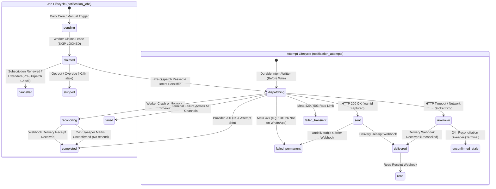
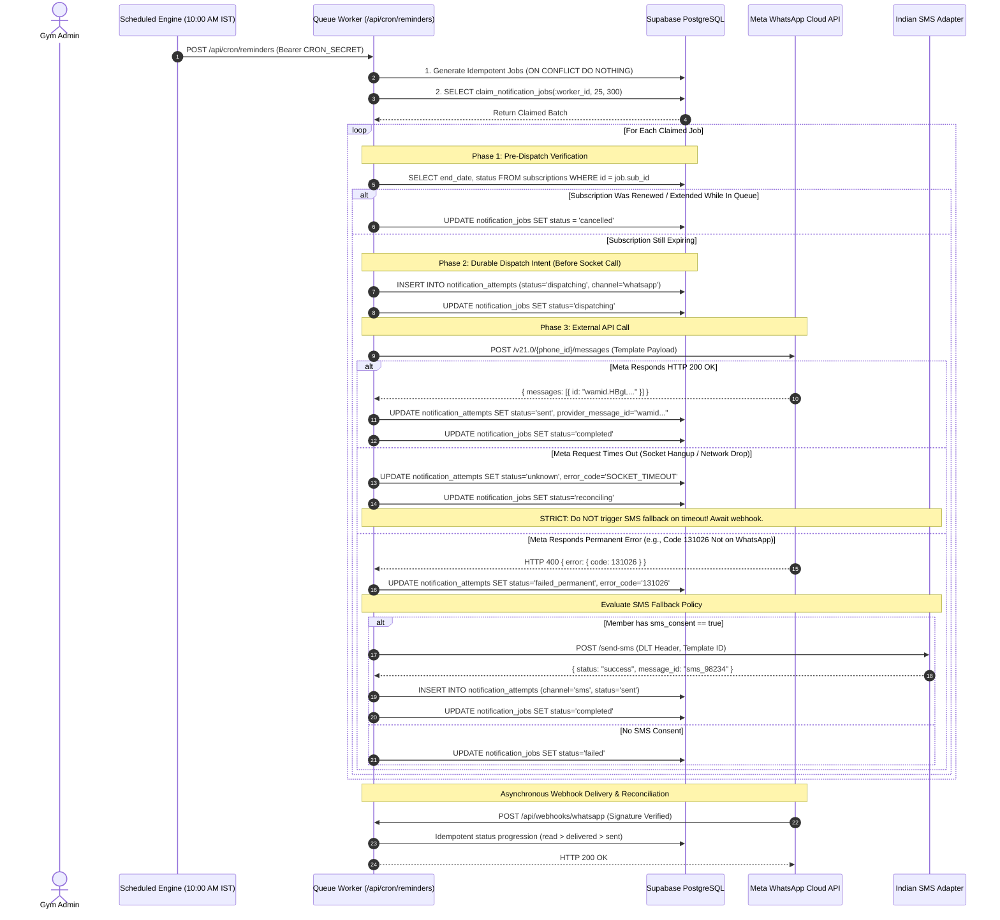
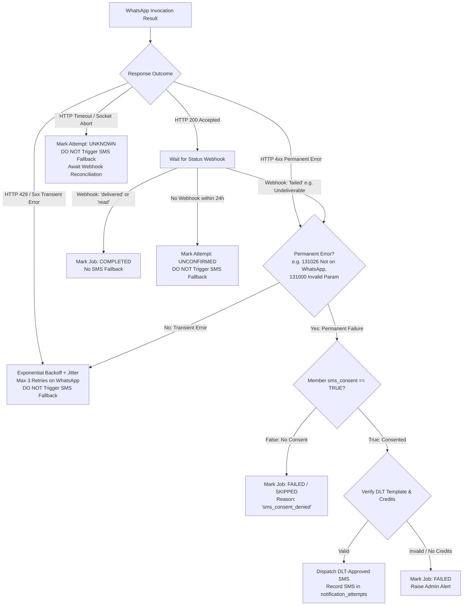

# System Architecture Document

## Gym Membership Management and Automated Notification System

**Document Version:** 1.0.0  
**Status:** Approved for Technical Architecture  
**Author:** Chief Technology Officer & Principal Software Architect  
**Target Environment:** Vercel (Frontend & Serverless Functions) + Supabase (PostgreSQL & Auth)

---

### 1. Architectural Overview & Design Philosophy

The system is architected as a modern, decoupled, cloud-native web application designed for high operational reliability, strict security, and cost efficiency. The architecture prioritizes:
1. **Stateless Frontend Application:** Built with React, TypeScript, and Vite, served via Vercel’s global Edge network.
2. **Transactional Relational Core:** Hosted on managed Supabase PostgreSQL, leveraging Row Level Security (RLS) for data isolation, database-level integrity constraints, and transactional ACID guarantees.
3. **Decoupled Asynchronous Queue:** Scheduled notification generation and actual message dispatch are completely decoupled. Database records act as persistent, recoverable job queues with row-level locking semantics (`FOR UPDATE SKIP LOCKED`).
4. **Idempotent Messaging Pipeline:** Outbound notifications use deterministically hashed idempotency keys to guarantee that network retries or overlapping cron jobs never deliver duplicate WhatsApp or SMS messages.
5. **Secure Trust Boundaries:** Sensitive API secrets (Meta WhatsApp tokens, SMS provider keys, webhook signing secrets) reside strictly in serverless runtime environments and are never exposed to the client browser.

---

### 2. Technology Stack & Component Justifications

| Component | Technology | Rationale & Architectural Trade-offs |
| :--- | :--- | :--- |
| **Frontend Framework** | React 18 / 19 + TypeScript | High developer velocity, strict type safety across business entities, rich ecosystem for data tables and form handling. |
| **Build Tool & Bundler** | Vite | Instant HMR, minimal build times, optimized tree-shaking, zero configuration overhead compared to legacy Webpack. |
| **Styling & UI Tokens** | Tailwind CSS | Utility-first CSS ensuring lightweight production stylesheets, responsive layouts, consistent color tokens, and full dark/light aesthetic control. |
| **Iconography** | Lucide React | Modern, accessible, highly tree-shakeable SVG icon set matching enterprise administrative designs. |
| **Database & Auth** | Supabase (PostgreSQL 15+) | Enterprise-grade PostgreSQL with declarative RLS, built-in secure JWT authentication, native JSONB support, and migration tooling. |
| **Server-Side API** | Vercel Serverless Functions (Node.js / TypeScript) | Zero-maintenance compute, scales to zero to eliminate idle server costs, sub-second cold starts, native integration with Vercel Cron. |
| **Validation Layer** | Zod | Runtime schema validation matching compile-time TypeScript types for all API inputs, webhooks, and spreadsheet imports. |
| **Primary Messaging** | Meta WhatsApp Cloud API | Official, carrier-grade WhatsApp Business messaging; high delivery rates in India; real-time delivery receipt webhooks. |
| **Fallback Messaging** | Indian SMS Provider Adapter (DLT) | Pluggable interface for Indian aggregators (Fast2SMS / MSG91); TRAI-compliant sender headers and template validation. |

#### Architectural Decision: Supabase PostgreSQL vs. Google Sheets as Primary Database
A common anti-pattern in small-scale business software is utilizing Google Sheets or Airtable as the primary production database to reduce initial hosting costs. We explicitly reject Google Sheets as a primary datastore for the following critical architectural reasons:
1. **Concurrency and Race Conditions:** Google Sheets API lacks atomic transactional locking (`SELECT FOR UPDATE`). When multiple staff members renew memberships or when a scheduled cron job dispatches reminders simultaneously, Sheets API results in race conditions, corrupted rows, and silent overwrite failures.
2. **Row-Level Security & Access Control:** Supabase enforces database-level Row Level Security (RLS) policies tied to cryptographic JWTs. Google Sheets provides only all-or-nothing sheet permissions, making it impossible to enforce least-privilege staff access.
3. **Queue Mechanics (`FOR UPDATE SKIP LOCKED`):** Reliable asynchronous job queues require row-level locking where workers can atomically claim pending jobs without blocking other workers. This is natively supported by PostgreSQL and completely impossible in spreadsheet APIs.
4. **Referential Integrity & Constraints:** Relational databases enforce `FOREIGN KEY`, `NOT NULL`, `CHECK`, and `UNIQUE` constraints at the engine level. Spreadsheets allow arbitrary malformed data insertion.
5. **Preserving Interoperability:** While Supabase serves as the immutable system of record, the system provides bidirectional CSV/Excel import and export capabilities, allowing gym owners to analyze data in Microsoft Excel or Google Sheets at will.

#### Hosting, Compute Runtimes & Deployment Boundaries
1. **Frontend Hosting (Vercel CDN):**
   - The compiled React SPA (HTML, JS, CSS, assets) is deployed to global CDN edge caches. Zero server execution occurs for frontend page rendering.
2. **Backend API Functions (Vercel Serverless Node.js Runtime):**
   - All `/api/*` endpoints run on standard **Node.js 20.x Serverless Runtime**, explicitly **NOT** the Vercel Edge Runtime.
   - *Rationale:* Node.js runtime provides full access to native `node:crypto` (required for constant-time HMAC verification and timing-safe token checks), standard PostgreSQL connection pooling, and 15–60 second maximum execution timeouts necessary for batch queue processing.
3. **Database Hosting (Supabase Managed PostgreSQL):**
   - Hosted in Singapore (`ap-southeast-1`) for low latency (< 60ms) to Indian users.
   - Database connection uses connection pooling (PgBouncer / Supabase Supavisor transaction mode on port `6543`) to prevent exhausting connection limits during serverless cold starts.
4. **Hosting Plan Constraints & Verifications:**
   - [VERIFIED] **Vercel Hobby Tier Constraints:** Vercel Hobby strictly limits cron executions to 1 run per day and explicitly forbids commercial business applications under Vercel Terms of Service (Commercial Use Clause). Production deployment legally requires **Vercel Pro ($20/seat/month)**.
   - [VERIFIED] **Supabase Free Tier Constraints:** Inactive free-tier projects pause after 7 consecutive days of zero traffic. While automated daily cron traffic keeps the project active, an extended cron outage (> 7 days) causes project pausing. Furthermore, free tier provides daily pg_dump backups (7-day retention) but **NO** Point-in-Time Recovery (PITR). Production environments requiring continuous backup protection should budget for **Supabase Pro ($25/month)**.

---

### 3. System Component Architecture Diagram

```mermaid
flowchart TB
    subgraph ClientBrowser [Client Tier: Admin Browser]
        UI[React + Vite Admin SPA]
        Tailwind[Tailwind CSS Design System]
        AuthClient[Supabase Auth Client - JWT]
    end

    subgraph CDN_Edge [Edge / Ingress Tier - Vercel]
        StaticCDN[Vercel Global CDN]
        ApiGateway[Vercel Serverless Functions /api/*]
        CronTrigger[Vercel Cron / Scheduled Engine]
    end

    subgraph DataTier [Database Tier - Supabase Cloud]
        PgAuth[Supabase GoTrue Auth]
        PgDb[(PostgreSQL 15+)]
        subgraph Tables [Schema: public]
            T_Gym[gym_settings]
            T_Members[members]
            T_Plans[membership_plans]
            T_Subs[subscriptions]
            T_Jobs[notification_jobs]
            T_Attempts[notification_attempts]
            T_Audit[audit_logs]
        end
        RLS[Row Level Security Engine]
    end

    subgraph ExternalProviders [External Messaging & Ingress]
        MetaCloud[Meta WhatsApp Cloud API]
        MetaWebhook[Meta Inbound Webhook Dispatcher]
        SmsGateway[Indian SMS Gateway / DLT Provider]
    end

    UI -->|1. Static Assets| StaticCDN
    UI -->|2. Authenticated REST / RPC| ApiGateway
    UI -->|3. Direct Client Read via RLS| PgDb
    
    CronTrigger -->|4. Authenticated Trigger (CRON_SECRET)| ApiGateway
    ApiGateway -->|5. Verify Token & Role| PgAuth
    ApiGateway -->|6. Service-Role Operations / Queue Claiming| PgDb
    
    ApiGateway -->|7. Business Template Message| MetaCloud
    ApiGateway -->|8. Fallback DLT SMS| SmsGateway
    
    MetaWebhook -->|9. Delivery Receipt Webhook (HMAC-SHA256)| ApiGateway
    ApiGateway -->|10. Idempotent Status Update| PgDb
```

---

### 4. Notification Engine Architecture, Queue Mechanics & Distributed Guarantees

The notification engine is architected as an asynchronous, state-machine-driven **producer-consumer pipeline** implemented directly on PostgreSQL. It explicitly accounts for the fallacies of distributed computing: networks are unreliable, latencies are non-zero, and third-party telecom aggregators can partition at any time.

#### 4.1. Distributed Guarantees: What Can and Cannot Be Guaranteed
1. **Database Guarantees (System of Record):**
   - **At-Most-Once Job Generation:** Enforced via `UNIQUE(idempotency_key)` where `idempotency_key = sha256(subscription_id || milestone || target_date)`. Multiple runs of the scheduler produce zero duplicate jobs.
   - **Mutual Exclusion & Non-Blocking Claiming:** Enforced via `SELECT ... FOR UPDATE SKIP LOCKED` inside a transaction.
   - **Lease Expiration & Crash Recovery:** Jobs are leased with `lease_expires_at = NOW() + INTERVAL '5 minutes'`. If a worker dies mid-execution, another worker safely reclaims the job after lease expiry.
2. **Provider Guarantees (Meta & Carrier Aggregators):**
   - **At-Least-Once Webhook Delivery:** Meta guarantees webhooks are retried with exponential backoff until an HTTP 200 is acknowledged.
   - **Acceptance $\neq$ Delivery:** An HTTP 200 response from Meta Graph API signifies only that the payload was syntactically accepted. Final delivery confirmation occurs **only** when an asynchronous carrier delivery receipt webhook arrives.
3. **What Cannot Be Guaranteed (Distributed Reality):**
   - **Zero Duplicate Deliveries Across Network Partitions:** If Meta accepts a message payload and transmits it to the telecom network, but the HTTP connection closes abruptly before the worker receives the response, the worker observes an `ECONNABORTED` timeout. Retrying the message risks duplicate delivery; suppressing it risks non-delivery. To handle this, the system enters an explicit **reconciliation state**.

#### 4.2. Decoupled Lifecycle State Machines

To prevent ambiguous states and duplicate message dispatches, the business-level reminder job lifecycle is completely decoupled from individual provider dispatch attempts through a **Two-Phase Dispatch Intent Protocol**:



#### 4.3. Atomic Job Claiming & Two-Phase Lease Recovery RPC
A lease expiration must **never**, by itself, authorize resending an external message. The worker might have transmitted the request immediately before crashing. Serverless workers claim pending jobs and recover orphaned leases using `claim_notification_jobs()`, which strictly verifies that no dispatch attempt was ever initiated:

```sql
-- Atomically claim pending jobs or orphaned leases whose workers timed out
-- Guard: Exclude jobs where a dispatch attempt was recorded (prevents duplicate messaging)
CREATE OR REPLACE FUNCTION public.claim_notification_jobs(
    p_worker_id text,
    p_batch_size integer DEFAULT 25,
    p_lease_duration_seconds integer DEFAULT 300
)
RETURNS SETOF public.notification_jobs
LANGUAGE plpgsql
SECURITY DEFINER
SET search_path = pg_catalog
AS $$
DECLARE
    v_lease_interval interval;
BEGIN
    v_lease_interval := (pg_catalog.concat(p_lease_duration_seconds::text, ' seconds'))::interval;

    RETURN QUERY
    WITH eligible_jobs AS (
        SELECT id
        FROM public.notification_jobs
        WHERE 
            (status = 'pending'::public.notification_job_status_enum AND scheduled_for <= pg_catalog.now())
            OR 
            (
                status = 'claimed'::public.notification_job_status_enum 
                AND lease_expires_at < pg_catalog.now() 
                AND attempt_count < max_attempts
                -- CRITICAL GUARD: Only reclaim if no dispatch attempt was ever initiated
                AND NOT EXISTS (
                    SELECT 1 FROM public.notification_attempts a 
                    WHERE a.job_id = public.notification_jobs.id 
                    AND a.status IN ('dispatching'::public.notification_attempt_status_enum, 'sent'::public.notification_attempt_status_enum, 'unknown'::public.notification_attempt_status_enum)
                )
            )
        ORDER BY scheduled_for ASC
        LIMIT p_batch_size
        FOR UPDATE SKIP LOCKED
    )
    UPDATE public.notification_jobs j
    SET 
        status = 'claimed'::public.notification_job_status_enum,
        claimed_at = pg_catalog.now(),
        lease_expires_at = pg_catalog.now() + v_lease_interval,
        worker_id = p_worker_id,
        attempt_count = j.attempt_count + 1,
        updated_at = pg_catalog.now()
    FROM eligible_jobs e
    WHERE j.id = e.id
    RETURNING j.*;
END;
$$;
```

#### 4.4. Sequence Diagram: Resilient Reminder Pipeline & Webhook Reconciliation



---

### 5. SMS Fallback Decision Engine & Failure Classification



---

### 6. Security Boundaries & Data Isolation

```mermaid
flowchart LR
    subgraph PublicZone [Untrusted Public Internet]
        BrowserUser[Admin / Staff Browser]
        MetaServer[Meta Webhook Server]
    end

    subgraph TrustBoundary1 [Edge Security Layer]
        CORS[CORS Policy & CSRF Defense]
        AuthGate[Supabase JWT Verification Gate]
        SigGate[HMAC-SHA256 Signature Verifier]
        RateLimiter[IP & Identity Rate Limiter]
    end

    subgraph TrustBoundary2 [Internal Secure Services]
        ServerlessFns[Serverless Execution Context]
        EnvSecrets[Environment Secret Store<br/>META_APP_SECRET, SUPABASE_SERVICE_KEY]
    end

    subgraph TrustBoundary3 [Data Storage Boundary]
        PostgresEngine[(PostgreSQL Engine)]
        RLSEngine{Row Level Security<br/>auth.uid() = gym_owner}
    end

    BrowserUser -->|HTTPS + JWT Bearer| CORS --> AuthGate --> ServerlessFns
    BrowserUser -->|Direct Supabase Client Read| RLSEngine --> PostgresEngine
    MetaServer -->|POST Webhook + Signature| SigGate --> ServerlessFns
    
    ServerlessFns -->|Read Encrypted Vars| EnvSecrets
    ServerlessFns -->|Service-Role Connection| PostgresEngine
```

---

### 7. Import / Export Data Pipeline & Formula Injection Defense

Exporting data to CSV or Excel introduces severe vulnerability risks if user inputs contain spreadsheet formula injection strings.
1. **Formula Injection Sanitization:**
   - Any text cell beginning with `=`, `+`, `-`, `@`, `\t`, or `\r` can execute arbitrary commands or exfiltrate data when opened in Microsoft Excel or LibreOffice.
   - All string exports pass through an escaping sanitizer that prefixes vulnerable characters with a single quote (`'`), neutralizing spreadsheet formula parsing.
2. **Streaming Import Architecture:**
   - Imports do not perform blind bulk database insertions.
   - Uploaded files are parsed client-side using `PapaParse` or `xlsx`.
   - Rows are validated against a strict Zod schema checking for:
     - Phone number normalization (E.164, valid 10-digit Indian pattern).
     - Name character constraints.
     - Valid ISO date strings.
   - The UI presents a dry-run confirmation table showing:
     - Total rows detected.
     - New valid members ready for import.
     - Duplicate phone numbers matching existing records (flagged for review/skip).
     - Malformed rows with specific column errors.
