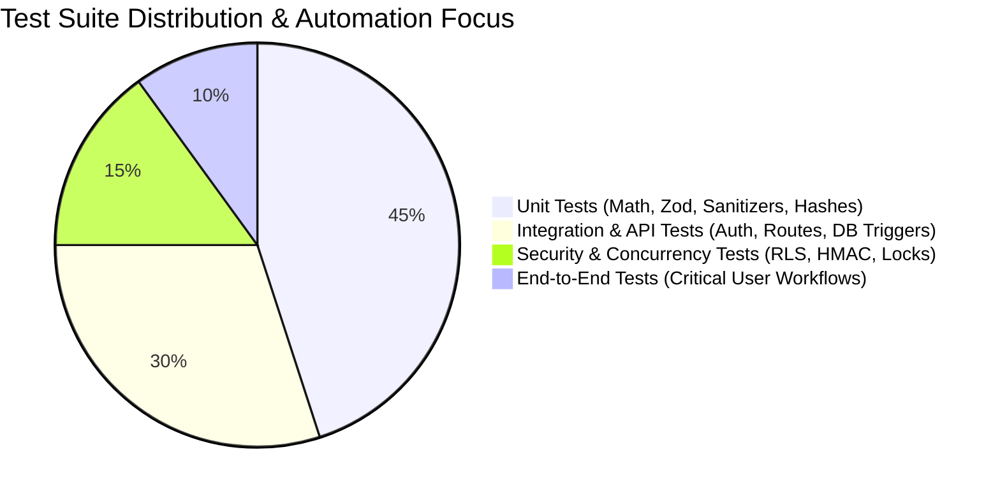

# Test Strategy & Quality Assurance Plan

## Gym Membership Management and Automated Notification System

**Document Version:** 1.0.0  
**Status:** Approved for Technical Architecture  
**Lead:** QA & Test Automation Lead  
**Test Frameworks:** Vitest (Unit/Integration), Supertest (API), Playwright (E2E), pgTAP (Database RLS)

---

### 1. Quality Philosophy & Testing Pyramid

The testing strategy is designed around deterministic validation of business logic, high-concurrency safety, and strict regulatory compliance. Because this system automates real customer communications and handles financial membership lifecycles, regressions in date calculations or idempotency keys could result in severe customer harassment or missed renewals.



---

### 2. Testing Levels & Detailed Test Suites

#### 2.1. Unit Test Suite (Vitest)
Unit tests run in sub-second memory execution and require zero network or database dependencies.

1. **Date & Timezone Calculations (`Asia/Kolkata`):**
   - Assert correct target date calculations across month boundaries (e.g., January 31 + 3 days = February 3).
   - Assert leap-year handling (e.g., February 28, 2028 + 1 day = February 29, 2028).
   - Assert that evaluation at 10:00 AM IST matches the identical local calendar day regardless of server running in UTC.
   - **Staleness Policy Test:** When evaluating a missed run with a target date 48 hours in the past, assert that the evaluator tags the job as `skipped` (`milestone_overdue_stale`).
2. **Idempotency Key Determinism:**
   - Verify that identical inputs `(subscription_id, milestone, target_date)` consistently produce the exact same SHA-256 hash.
   - Verify that differing milestones or dates produce completely unique hashes.
3. **Zod Input Validation:**
   - Valid Indian phone numbers: `+919876543210` $\rightarrow$ Pass.
   - Invalid phone formats: `9876543210` (missing +91), `+911234567890` (starts with 1), `+14155552671` (US number) $\rightarrow$ Fail with descriptive field errors.
   - Negative subscription amounts or inverted start/end dates $\rightarrow$ Fail validation.
4. **CSV Formula Injection Sanitization:**
   - Input: `=CMD|' /C calc'!A0` $\rightarrow$ Output: `'=CMD|' /C calc'!A0`
   - Input: `@SUM(A1:A10)` $\rightarrow$ Output: `'@SUM(A1:A10)`
   - Input: `Normal Member Name` $\rightarrow$ Output: `Normal Member Name` (unmodified).

#### 2.2. Database & RLS Integration Tests (Supabase / pgTAP)
Executed against an ephemeral test PostgreSQL database migrated with the complete DDL schema.

1. **Privileged Function Security & RPC Access Control:**
   - **Unauthorized Execution Test:** Connect as `anon` role and attempt `SELECT public.current_user_gym_id()`. Assert PostgreSQL raises `42501 (permission_denied)`.
   - **Trigger RPC Invocation Test:** Connect as `authenticated` staff role and attempt direct invocation `SELECT public.cancel_stale_notification_jobs_on_renewal()`. Assert PostgreSQL raises `42501 (permission_denied)`.
   - **Queue Claim RPC Role Check:** Connect as `authenticated` staff role and attempt `SELECT public.claim_notification_jobs('worker_1')`. Assert PostgreSQL raises `42501 (permission_denied)`.
2. **Search Path Hardening & Object Shadowing Exploit Test:**
   - Create an unprivileged schema `attacker_schema` with a malicious shadowed function `now()` or custom operator `=`.
   - Call `current_user_gym_id()` or `claim_notification_jobs()` with `search_path` set to `attacker_schema, public`.
   - Assert that the functions execute strictly using `pg_catalog` and `public` definitions without executing attacker code.
3. **Multi-Tenant RLS Boundary Isolation:**
   - Seed Gym A (User A) and Gym B (User B).
   - Authenticate as User A and issue `SELECT * FROM members`. Assert zero members from Gym B are returned.
   - Authenticate as User A and attempt an `UPDATE` on a Gym B member ID. Assert zero rows are affected.
4. **Database Triggers & Stale Reminder Invalidation:**
   - Create a member with a subscription expiring on 2026-10-31.
   - Insert a `pending` notification job for milestone `EXPIRY_ZERO` on 2026-10-31.
   - Issue a renewal inserting a new subscription with `start_date = 2026-11-01` and `end_date = 2027-10-31`.
   - Query the previous notification job. Assert `status = 'cancelled'` and `cancellation_reason = 'subscription_renewed_or_extended'`.
5. **Subscription Exclusion Constraint Tests:**
   - Attempt to insert an active subscription whose `daterange(start_date, end_date, '[]')` overlaps an existing active subscription for the same member.
   - Assert PostgreSQL raises `23P01 (exclusion_violation)` via `no_overlapping_active_subscriptions`.
   - Insert a legitimate contiguous future-dated subscription (`start_date = active.end_date + 1 day`). Assert successful insert without violation.

#### 2.3. Webhook Signature & Security Tests
1. **Meta Webhook Signature Verification:**
   - POST with valid `X-Hub-Signature-256` matching computed HMAC $\rightarrow$ Assert HTTP 200.
   - POST with tampered payload body $\rightarrow$ Assert HTTP 401.
   - POST with mismatched string length $\rightarrow$ Assert HTTP 401 (gracefully rejected without throw).
   - POST replayed payload with existing `event_id` $\rightarrow$ Assert HTTP 200 returned immediately without duplicate DB processing.
2. **Out-of-Order Webhook Delivery Test:**
   - Seed attempt in state `dispatching`.
   - Ingest webhook with status `delivered` $\rightarrow$ Assert attempt transitions to `delivered`.
   - Ingest delayed webhook with status `sent` for the same `wamid` $\rightarrow$ Assert attempt remains `delivered` (no state regression).
3. **Cron Endpoint Secret Verification:**
   - POST `/api/cron/reminders` with valid `Bearer <CRON_SECRET>` $\rightarrow$ Assert HTTP 200.
   - POST without Authorization header $\rightarrow$ Assert HTTP 401.
   - POST with invalid secret $\rightarrow$ Assert HTTP 401 (verified constant-time comparison).

#### 2.4. Concurrency, Worker Crash Recovery & Idempotency Tests
1. **Concurrent Renewal Serialization Test:**
   - Launch two concurrent HTTP POST requests to `/api/subscriptions/renew` for the same member.
   - Assert that the PostgreSQL row lock on `members` serializes execution, creating two consecutive non-overlapping subscriptions without primary key or check violations.
2. **Renewals from Different Historical Subscriptions:**
   - Member holds historical Sub 1 and Sub 2. Staff A requests renewal from Sub 1; Staff B requests renewal from Sub 2 with overlapping dates.
   - Assert that the exclusion constraint blocks the second renewal with `23P01 exclusion_violation` and returns HTTP 409 Conflict.
3. **Idempotent Renewal Retries:**
   - Submit renewal with `idempotency_key = "uuid-1"`.
   - Re-submit identical renewal payload with `idempotency_key = "uuid-1"` (simulating network timeout retry).
   - Assert HTTP 200 returned with existing subscription record; assert database contains exactly 1 row for that key.
4. **Worker Crash Before Dispatch Intent:**
   - Seed a job with `status = 'claimed'`, `lease_expires_at = NOW() - INTERVAL '1 minute'`, with NO attempt in `dispatching`.
   - Call `claim_notification_jobs('worker_2')`.
   - Assert worker 2 successfully reclaims the job.
5. **Worker Crash After Dispatch Intent:**
   - Seed a job with `status = 'dispatching'`, `lease_expires_at = NOW() - INTERVAL '1 minute'`, with an attempt in `status = 'dispatching'`.
   - Call `claim_notification_jobs('worker_2')`.
   - Assert worker 2 **skips** the job (zero duplicate dispatch). Job transitions to `reconciling`.
6. **Expired Lease with Uncertain Delivery Outcome:**
   - Worker dispatches WhatsApp message, observes timeout, updates attempt to `unknown`.
   - Assert job enters `reconciling`. Verify that after 5 minutes, subsequent workers do NOT re-dispatch.
7. **Recovery from Failed / Interrupted Database Transaction:**
   - Simulate a crash or exception midway through subscription renewal after member lock acquisition.
   - Assert transaction rolls back completely; zero partial rows created in `subscriptions`, member lock released cleanly.

#### 2.5. Mock Provider & SMS Fallback Suite
Simulate external communication providers using MSW (Mock Service Worker).

```mermaid
flowchart TD
    TestCase[Test Scenario] --> MockRouter{Provider Response}
    
    MockRouter -->|Meta Returns 200 OK| TestSuccess[Assert Attempt status='sent'<br/>Assert SMS Fallback NOT Called]
    MockRouter -->|Meta Times Out (Socket Drop)| TestTimeout[Assert Attempt status='unknown'<br/>Assert SMS Fallback STRICTLY NOT Called<br/>Job status='reconciling']
    MockRouter -->|Meta Returns 400 Code 131026| TestFallback{Check Member SMS Consent}
    MockRouter -->|Meta Returns 500 Transient| TestRetry[Assert Job status='claimed'<br/>Exponential Backoff Scheduled]
    
    TestFallback -->|sms_consent = true| TriggerSMS[Assert Fallback SMS Dispatched<br/>Assert DLT Template ID Present]
    TestFallback -->|sms_consent = false| SkipSMS[Assert Job status='failed'<br/>Assert SMS Provider NOT Called]
```

#### 2.6. Target Environment Classification Matrix for Planned Tests

| Test Scenario | Unit Test (In-Memory) | Integration Test (API + Mock) | Real Disposable PostgreSQL / Supabase Environment |
| :--- | :---: | :---: | :---: |
| Unauthorized RPC invocation on privileged functions | ❌ | ❌ | **Mandatory (Real DB Role Context)** |
| Search-path injection & object shadowing exploit | ❌ | ❌ | **Mandatory (Real DB Schema Catalog)** |
| Cross-tenant RLS isolation checks | ❌ | ❌ | **Mandatory (Real Supabase Auth Context)** |
| Two concurrent renewals for same member | ❌ | ❌ | **Mandatory (Real DB Row Locking)** |
| Renewals from different historical subscriptions | ❌ | ❌ | **Mandatory (Real GiST Exclusion Constraint)** |
| Legitimate future-dated subscription validation | ❌ | ❌ | **Mandatory (Real DB Engine)** |
| Idempotent renewal repeated after network timeout | ❌ | **Yes (Supertest + DB)** | **Mandatory** |
| Worker crash before dispatch intent | **Yes (Mock DB)** | **Yes** | Recommended |
| Worker crash after dispatch intent | ❌ | **Yes** | **Mandatory (Real RPC Claim)** |
| Expired lease with uncertain delivery outcome | ❌ | **Yes** | Recommended |
| Delayed and duplicate provider webhooks | ❌ | **Yes (API Test)** | Recommended |
| WhatsApp timeout with SMS fallback prohibited | **Yes (MSW)** | **Yes** | Optional |
| Verified permanent WhatsApp failure with consent checks | **Yes (MSW)** | **Yes** | Optional |
| Renewal invalidating queued reminder | ❌ | ❌ | **Mandatory (Real Database Trigger)** |
| Renewal occurring during in-flight reminder | **Yes** | **Yes** | Recommended |
| Interrupted transaction rollback | ❌ | ❌ | **Mandatory (Real ACID Engine)** |

#### 2.6. End-to-End (E2E) Browser Tests (Playwright)
Automated browser tests validating critical administrative workflows in desktop and mobile viewports.

1. **Workflow 1: Member Registration & Instant Plan Assignment:**
   - Log in as Gym Admin.
   - Navigate to Members $\rightarrow$ "Add New Member".
   - Fill valid details, select "3 Months Quarterly" plan, select "Paid via UPI".
   - Submit form $\rightarrow$ Verify member card appears in active list with accurate expiry date.
2. **Workflow 2: Membership Renewal Flow:**
   - Select an expiring member.
   - Click "Renew Subscription".
   - Verify start date defaults to `current_expiry + 1 day`.
   - Submit $\rightarrow$ Verify subscription timeline shows both old and new subscription periods.
3. **Workflow 3: Reminder Preview & Manual Trigger:**
   - Navigate to Reminder Center.
   - Click "Preview Message" on an upcoming reminder.
   - Assert rendered text matches member name and expiry date.
   - Click "Trigger Now" $\rightarrow$ Verify status updates from pending to sent.
4. **Workflow 4: CSV Import Dry-Run & Commit:**
   - Upload sample CSV with 5 valid rows and 1 duplicate row.
   - Verify dry-run preview table highlights the duplicate row in red.
   - Click "Confirm Import" $\rightarrow$ Verify exactly 5 members created in database.

---

### 3. Production Release Gate & Verification Criteria

Before promoting any build to production, the deployment pipeline must satisfy all criteria:

| Gate | Check Item | Threshold / Requirement |
| :--- | :--- | :--- |
| **Unit & Integration** | Vitest Test Suite | 100% pass rate; > 85% statement coverage. |
| **Database Migrations** | Schema idempotency test | Forward migrations apply cleanly on clean DB. |
| **Security Audit** | npm audit / Snyk | 0 Critical or High vulnerabilities in dependencies. |
| **Lint & Typecheck** | ESLint + TypeScript `tsc --noEmit` | 0 errors, 0 unresolved `any` types. |
| **RLS Verification** | Multi-tenant test matrix | 100% pass rate on cross-tenant access denial. |
| **E2E Smoke Tests** | Playwright headless run | All 4 core workflows pass in Chromium & Mobile Safari. |
| **Integrations** | Webhook signature handshake | Mock Meta verification handshake passes. |
